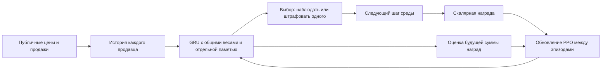

# Арбитр

[`PPOArbiter`](src/ppo_arbiter/policy.py) обучается выбирать наблюдение или штраф
одному продавцу. У каждого участника своя память GRU, веса обработки общие.
Сумма штрафа фиксирована: 25 денежных единиц. Удорожания связей нет.

## Как работает обучаемая политика

Арбитр получает цены и продажи уже рассчитанного рынка, спрос, потребительский
излишек и их изменения. Он хранит историю цен и продаж, два лага цены,
изменения, скользящие статистики и сведения о собственных санкциях.
`SW*`, конкурентная цена, издержки, граф и состав коалиций не входят в модель.



Веса обновляются по пошаговым наградам после восьми завершённых эпизодов.
GAE связывает последующие награды с предыдущими решениями; отдельной модели
будущего рынка нет. По умолчанию награда обучает PPO и не подаётся на вход
политики. `settings.use_previous_reward: true` добавляет предыдущую собственную
награду в следующее наблюдение, также при оценке. Текущая награда до решения
неизвестна; прямые метки FP/FN не передаются.

`settings.separate_critic: true` включает отдельные encoder, GRU и контекст
для критика. У актёра и критика остаётся индивидуальная память продавцов,
но градиенты их рекуррентных сетей больше не смешиваются. По умолчанию опция
выключена. Дополнительные reward-колонки начинаются с нулевых весов, а критик
копирует начальные веса актёра: начальные предсказания вариантов совпадают.
Опции выбираются до обучения и сохраняются в checkpoint; менять их при
загрузке обученной модели нельзя.

В режиме `eval` веса заморожены. `evaluation: greedy` выбирает наиболее
вероятное отдельное действие: наблюдение либо штраф конкретному продавцу.
`evaluation: sample` выбирает из распределения с воспроизводимым seed.
Вероятность штрафа всем целям вместе не равна вероятности отдельного штрафа;
режимы нужно явно указывать при сравнении.

Правило среды ограничивает сумму одного штрафа. Дополнительно политика по
умолчанию выдерживает пять шагов между санкциями и ограничивает взыскания
с одного продавца суммой 100 за эпизод. Недоступные действия маскируются до
выбора. Бюджет учитывает фактически применённые штрафы из `last_action`.
Денежный остаток меньше полного штрафа не используется.

Штраф списывается после расчёта рынка и дележа: он снижает доход и баланс цели,
а также общую награду коалиции. Другим участникам среды он автоматически не
распределяется. Уже рассчитанный излишек этого шага штраф не улучшает.

## Запуск PPO

```bash
python -m pip install -e '.[learning]'
python -m social_market_env.run experiments/arbiter_ppo_train.yaml
python -m social_market_env.run experiments/arbiter_ppo_eval.yaml
```

Конфиг оценки загружает выбранную модель `both`, seed=0: прошлая награда и
отдельный критик включены, выбор действия плоский, режим оценки — `greedy`.
Её настройки и SHA-256 весов закреплены в
[`experiments/arbiter_ppo_model.json`](experiments/arbiter_ppo_model.json).
Сами веса лежат локально в `runs/ppo_arbiter/both_seed_0_best.pt`, вне Git.
Обучающий пример сохраняет другую модель в `runs/ppo_arbiter/latest.pt`
и не перезаписывает выбранные веса. Для оценки своего обучения нужно изменить
`checkpoint_path`. Новое обучение не гарантирует повторения выбранной политики.

Примеры показывают подключение и сохранение модели на простом рынке.
Обучение только против полной коалиции не проверяет способность отличать её
от независимых продавцов. Диагностический стенд с разными сценариями и отчёт
находятся в исследовательском репозитории.

Класс: `ppo_arbiter:PPOArbiter`. В `arbiter.policy.kwargs` задаются:

- `model_seed` — инициализация весов;
- `settings` — параметры из [`Settings`](src/ppo_arbiter/settings.py), включая
  фиксированный `fine_amount`, `fine_cooldown` и `fine_budget`;
- `checkpoint_out` — сохранение обучаемой модели после эпизода;
- `checkpoint_path` — загрузка для оценки или продолжения обучения.
- `evaluation` — `greedy` или `sample` при замороженных весах.

Для продолжения задаются оба пути. Checkpoint включает веса, Adam и ещё не
использованные завершённые эпизоды. `reset` очищает память рынка, сохраняя
обучение. Сохранение и обновление PPO выполняются на границе эпизодов.
Лимиты `min_fine`/`max_fine` в settings должны совпадать с ограничениями среды.
При обрезке действия во время обучения политика сообщает ошибку, чтобы не
обучаться на другом действии. Файлы весов сохраняются в игнорируемом `runs/`.

При создании без checkpoint веса случайные. Качество нового рынка проверяется
отдельно; наличие PPO и GRU не гарантирует полезных санкций.

## Правило для сравнения

`preventive_arbiter:PreventiveArbiter` сохранён как отдельный вариант на правилах.
Он использует передаваемый средой SW* и восстановленный ценовой ориентир,
ожидает четыре последовательных шага дефицита SW выше 8% и высоких цен
минимум двух продавцов, затем штрафует одного. Это эвристика, не доказательство
сговора; её пороги не используются в PPO.

```bash
python -m social_market_env.run experiments/arbiter_preventive.yaml
```

Для статической сети: `experiments/arbiter_preventive_static.yaml`.
Параметры передаются через `arbiter.policy.kwargs`; объяснение последнего
решения содержится в `last_decision`. Правило не обучается.

Проверки, диагностические сценарии и результаты находятся в
[arbiter-research-and-design](https://github.com/ITMO-FPIN-SMA-2026/arbiter-research-and-design).
