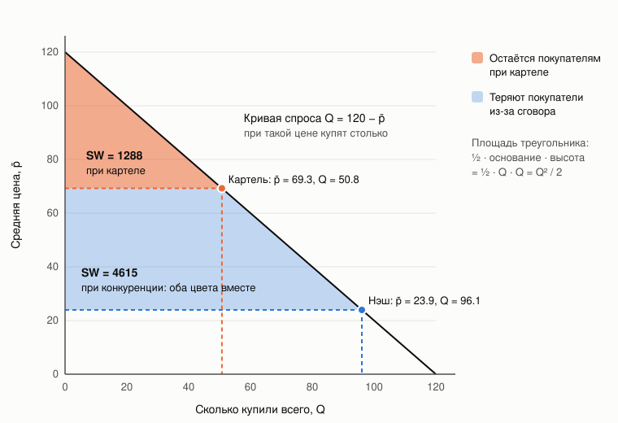
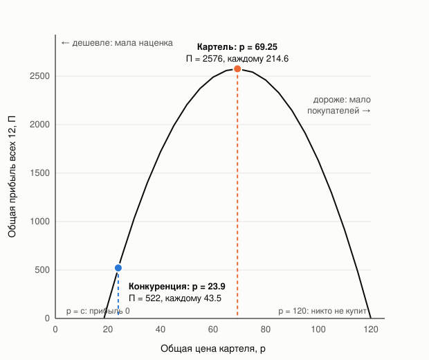

# Разбор 01 — Рынок и теория игр

> [Разбор 00 — Оглавление](README.md) · следующая: [Разбор 02 — Как коалиция подключена к среде](02-environment-contract.md)
> В этой части нет нашего кода. Здесь объясняется мир, в котором он работает: формулы из `social_market_env/core/market.py` и `gametheory/equilibrium.py`.

## 1. Рынок за одну минуту

Есть 12 продавцов одного и того же товара. На каждом шаге каждый назначает цену. Покупатели:

1. решают, **сколько купить всего**, глядя на среднюю цену;
2. решают, **у кого купить**, глядя на то, кто дешевле.

Прибыль продавца — наценка, умноженная на проданное количество.

## 2. Формулы рынка

### 2.1. Общий спрос

$$Q=\max\bigl(0,\ A-B\,\bar p\bigr),\qquad \bar p=\frac1N\sum_i p_i$$

Чем дороже в среднем, тем меньше покупают. При $A=120$, $B=1$ и средней цене 24 продаётся $Q=96$ единиц.

### 2.2. Кому достанутся покупатели: logit-доли

$$s_i=\frac{e^{-(p_i-p_{\min})/\tau}}{\sum_j e^{-(p_j-p_{\min})/\tau}}$$

Это формула «мягкого минимума». Кто дешевле, тот получает экспоненциально больше покупателей. Параметр $\tau$ задаёт, насколько резко они реагируют:

- $\tau\to 0$: все идут к самому дешёвому;
- $\tau\to\infty$: все делят рынок поровну.

Вычитание $p_{\min}$ на результат не влияет, оно нужно, чтобы экспоненты не переполнялись.

**Пример.** Два продавца, цены 24 и 26, $\tau=5$:

$$e^{0}=1,\quad e^{-2/5}=0.670\ \Rightarrow\ s_1=\frac{1}{1.670}=0.599,\ s_2=0.401$$

Разница в цене в 2 единицы, около 8 %, сдвигает 20 % рынка. Это важно: при таких покупателях обманщик, чуть снизивший цену, забирает почти весь рынок.

### 2.3. Продажи и прибыль

$$q_i=Q\,s_i,\qquad \pi_i=(p_i-c_i)\,q_i$$

В коде это `clear_market` из `core/market.py`. Её мы вызываем постоянно, и в части 08 она переписана векторно сразу для тысяч вариантов.

### 2.4. Благосостояние покупателей

SW (social welfare) в среде — это **выгода покупателей**. Разберём по шагам, что это и почему она считается по такой простой формуле.

#### Шаг 1. Выгода одного покупателя

У каждого покупателя есть **предельная цена** — сколько он максимум готов заплатить. Если товар стоит меньше, покупатель покупает и экономит разницу.

> Покупатель готов отдать до 100, а товар стоит 24. Он покупает и выигрывает $100-24=76$.
> Покупатель готов отдать до 30 — выигрывает 6.
> Покупатель готов отдать до 20 — при цене 24 не покупает и ничего не выигрывает.

**SW — сумма таких выигрышей всех, кто купил.** Экономисты называют это **излишком потребителя**.

#### Шаг 2. Кривая спроса — это очередь покупателей

Выстроим покупателей по убыванию предельной цены: сначала самые нетерпеливые, потом остальные. В нашей среде эта очередь — прямая линия:

$$Q=A-B\,\bar p\qquad\text{при }A=120,\ B=1:\quad Q=120-\bar p$$

Как её читать: при цене $\bar p$ купят все, чья предельная цена не ниже $\bar p$, и таких ровно $Q=120-\bar p$.

| Цена | Сколько купят | Кто остался без покупки |
|---:|---:|---|
| 0 | 120 | Никто |
| 24 | 96 | Те, кто готов платить меньше 24 |
| 69 | 51 | Те, кто готов платить меньше 69 |
| 120 | 0 | Все |

#### Шаг 3. Сумма выигрышей — это площадь треугольника

На рисунке по горизонтали — покупатели в очереди, по вертикали — цена. Высота кривой спроса над точкой $q$ — предельная цена $q$-го покупателя. Его выигрыш — расстояние от кривой спроса **до линии цены**.

Если сложить эти отрезки по всем купившим, получится площадь фигуры между кривой спроса и горизонтальной линией цены. Это прямоугольный треугольник:

- **основание** — сколько купили, $Q$;
- **высота** — от цены до точки, где кривая спроса пересекает вертикальную ось, то есть до 120: $\ 120-\bar p=Q$.

$$SW=\frac12\cdot\text{основание}\cdot\text{высота}=\frac12\cdot Q\cdot Q=\frac{Q^2}{2}$$

В общем виде, при любом наклоне $B$, высота равна $A/B-\bar p=Q/B$, и

$$SW=\frac{Q^2}{2B}$$

#### Шаг 4. Числа

| | Средняя цена | $Q=120-\bar p$ | $SW=Q^2/2$ | Падение SW |
|---|---:|---:|---:|---:|
| Конкуренция (Нэш) | 23.93 | 96.07 | 4615 | 0 % |
| Небольшой сговор | 27.35 | 92.65 | 4292 | 7 % |
| Сильный сговор | 40 | 80 | 3200 | 31 % |
| Картель | 69.25 | 50.75 | 1288 | 72 % |

На рисунке синяя часть — то, что покупатели теряют при переходе от конкуренции к картелю: $4615-1288=3327$. Потеря двойная: оставшиеся покупатели платят дороже, а часть покупателей вообще уходит без покупки.

#### Шаг 5. Почему это главное свойство для всей политики

Цепочка зависимостей очень короткая:

$$\bar p\ \longrightarrow\ Q=A-B\bar p\ \longrightarrow\ SW=\frac{Q^2}{2B}$$

**SW зависит только от средней цены.** Не важно, кто именно поднял цену и как распределены продажи между продавцами.

Отсюда простое правило: **не дать SW упасть ниже порога — это то же самое, что не поднимать среднюю цену выше определённого уровня**. Например, «SW не ниже 93 % от конкурентного» означает «средняя цена не выше 27.35». Этот перевод из процентов в цену делает функция `mean_price_cap`, и на нём построено всё ценообразование в [Разбор 07 — Цена](07-pricing.md).

Чем сильнее цена отходит от конкурентной, тем быстрее падает SW: она зависит от $Q$ в квадрате. Первые единицы сговора стоят покупателям немного, дальнейшие — всё дороже. Поэтому умеренный сговор почти не заметен по SW, а картельная цена видна сразу.

## 3. Конкуренция: равновесие Нэша

**Определение.** Набор цен, при котором никому не выгодно в одиночку менять свою цену.

**Наилучший ответ** агента — цена, максимизирующая его прибыль при фиксированных ценах остальных. Равновесие Нэша — точка, где каждый уже стоит на своём наилучшем ответе.

### 3.1. Как его считает среда

`nash_equilibrium` в `gametheory/equilibrium.py` повторяет «осторожные наилучшие ответы»:

$$p_i^{(k+1)}=0.5\,p_i^{(k)}+0.5\,\mathrm{BR}_i\bigl(p_{-i}^{(k)}\bigr)$$

Это продолжается, пока цены не перестанут двигаться (сдвиг меньше 0.02). Наилучший ответ ищется перебором: сначала с шагом 0.5 по всему отрезку $[1,100]$, затем с шагом 0.01 вокруг лучшей точки. Один расчёт занимает 10–80 мс.

### 3.2. Почему при конкуренции цена около 24

Численный расчёт среды даёт цену 23.93. Но откуда она? Можно вывести её руками и заодно понять, **что вообще удерживает цену** при конкуренции.

#### Идея: продавец ищет вершину холма

Представим одного продавца. Остальные 11 держат свои цены, а он пробует свою. Слишком низкая цена — почти нет наценки. Слишком высокая — покупатели уходят к соседям. Где-то посередине прибыль наибольшая: это вершина холма.

На вершине холма склон плоский: если чуть сдвинуть цену в любую сторону, прибыль почти не меняется. На языке математики это **условие первого порядка**: производная прибыли по цене равна нулю. Проще говоря:

> **На лучшей цене выигрыш от того, чтобы поднять цену на 1, равен проигрышу от этого.**

Посчитаем этот выигрыш и проигрыш.

#### Что меняется, если поднять цену на 1

Пусть все 12 продавцов одинаковые, с себестоимостью $c$ и ценой $p$. Тогда каждый продаёт $Q/N$ и получает наценку $p-c$ с каждой единицы.

Продавец поднимает свою цену на 1. Происходят три вещи.

**1. Выигрыш: каждая проданная единица приносит на 1 больше.** Продаёт он $Q/N$ единиц, значит, получает

$$+\frac{Q}{N}$$

**2. Проигрыш: весь рынок покупает чуть меньше.** Средняя цена выросла на $1/N$, общий спрос упал на $B/N$ единиц. Из них его доля $1/N$:

$$-(p-c)\cdot\frac{B}{N^2}$$

**3. Проигрыш: часть его покупателей уходит к соседям.** По формуле logit-долей при подъёме цены на 1 его доля падает примерно на $\frac{1}{N}\bigl(1-\frac1N\bigr)\frac{1}{\tau}$. Он теряет столько покупателей, умножить на наценку:

$$-(p-c)\cdot Q\cdot\frac{N-1}{N^2\tau}$$

#### Уравнение равновесия

На лучшей цене выигрыш равен сумме проигрышей:

$$\frac{Q}{N}=(p-c)\Bigl(\frac{B}{N^2}+\frac{Q\,(N-1)}{N^2\,\tau}\Bigr)$$

Умножим обе части на $N$ и выразим наценку:

$$p-c=\frac{Q}{B/N+Q\,(N-1)/(N\tau)}$$

#### Подставим числа

$c=18.5$, $N=12$, $\tau=5$, $B=1$, и при цене около 24 спрос $Q=96.07$.

| Что считаем | Формула | Значение |
|---|---|---:|
| Выигрыш от подъёма цены на 1 | $Q/N$ | +8.01 |
| Проигрыш: рынок покупает меньше | $5.43\cdot1/144$ | −0.04 |
| Проигрыш: покупатели уходят к соседям | $5.43\cdot96.07\cdot11/720$ | −7.97 |
| **Итог** | | **≈ 0** |

$$p-c=\frac{96.07}{1/12+96.07\cdot11/60}=\frac{96.07}{17.70}=5.43\ \Rightarrow\ p=18.5+5.43=23.93$$

Это ровно то, что даёт численный расчёт среды. Прибыль каждого $5.43\cdot96.07/12=43.5$, а $SW^*=96.07^2/2=4615$.

#### Главный вывод из таблицы

Почти весь проигрыш, 99.5 %, — **уход покупателей к соседям**. Падение общего спроса почти ничего не значит. Цену при конкуренции держит не то, что люди перестают покупать, а то, что **они покупают у другого**.

Если пренебречь маленьким вторым слагаемым, формула становится совсем простой:

$$p-c\ \approx\ \tau\cdot\frac{N}{N-1}$$

**Наценка при конкуренции примерно равна $\tau$** — «температуре» покупателей:

| Что меняется | Наценка $p-c$ | Почему |
|---|---:|---|
| $\tau=5$, 12 продавцов, наш случай | ≈ 5.45 | |
| $\tau=2$: покупатели резче уходят к дешёвым | ≈ 2.2 | Каждый подъём цены дороже обходится |
| $\tau=10$: покупателям почти всё равно | ≈ 10.9 | Можно накрутить больше |
| 2 продавца вместо 12 | ≈ 10 | Уходить почти не к кому |
| Продавцов очень много | → 5 | Уходить есть куда всегда |

**Аналогия.** Заправки на одной улице. Цены у всех почти одинаковые и чуть выше себестоимости. Если одна поднимет цену, водители просто проедут сто метров до соседней. Чем легче водителям перейти (маленькое $\tau$), тем ниже цены у всех.

## 4. Картель: если бы все договорились

### 4.1. Что такое картель

**Картель** — продавцы договорились действовать как одна большая фирма и назначать цены так, чтобы **общая** прибыль всех была максимальной.

Главное отличие от конкуренции: уход покупателей к соседу больше не проблема. Сосед — в том же картеле, и деньги остаются «внутри». В формуле из раздела 3.2 исчезает третье слагаемое, которое и держало цену низкой. Остаётся только одно ограничение: если поднять цену для всех, часть людей вообще перестанет покупать.

### 4.2. Компромисс: наценка или покупатели

Пусть все 12 держат одну и ту же цену $p$. Тогда доли равны, и считать нужно только общий рынок:

$$\text{общая прибыль}\quad\Pi=\underbrace{(p-c)}_{\text{наценка}}\cdot\underbrace{(A-Bp)}_{\text{сколько купят}}$$

Два множителя тянут в разные стороны:

- поднимаем цену — растёт наценка;
- поднимаем цену — уменьшается число покупателей.

| Цена | Наценка $p-18.5$ | Купят $120-p$ | Общая прибыль |
|---:|---:|---:|---:|
| 24 | 5.5 | 96 | 528 |
| 40 | 21.5 | 80 | 1720 |
| 60 | 41.5 | 60 | 2490 |
| **69.25** | **50.75** | **50.75** | **2576** |
| 80 | 61.5 | 40 | 2460 |
| 100 | 81.5 | 20 | 1630 |
| 120 | 101.5 | 0 | 0 |

### 4.3. Где вершина

График прибыли — парабола: перевёрнутая чаша. Вершина — там, где склон плоский, то есть где выигрыш от подъёма цены на 1 равен проигрышу:

- **выигрыш**: каждый из $A-Bp$ покупателей платит на 1 больше: $+(A-Bp)$;
- **проигрыш**: уходят $B$ покупателей, и с каждого теряется наценка: $-B(p-c)$.

$$A-Bp=B\,(p-c)\quad\Longrightarrow\quad p^{\text{картель}}=\frac{A/B+c}{2}=\frac{120+18.5}{2}=69.25$$

**Простой смысл:** оптимальная цена картеля — **ровно посередине** между себестоимостью (18.5) и ценой, при которой никто ничего не купит (120). На этой цене наценка 50.75 и покупателей тоже 50.75: именно поэтому их произведение максимально.

Это классическая цена **монополии** при линейном спросе: картель из 12 продавцов ведёт себя как один монополист.

### 4.4. Что выигрывают продавцы и что теряют покупатели

| | Цена | Прибыль каждого | Прибыль всех | Купили $Q$ | $SW$ покупателей |
|---|---:|---:|---:|---:|---:|
| Конкуренция (Нэш) | 23.93 | 43.5 | 522 | 96.1 | 4615 |
| Картель | 69.25 | 214.6 | 2576 | 50.75 | 1288 |
| **Изменение** | ×2.9 | **×5** | +2054 | −45 | **−3327 (−72 %)** |

Подведём общий итог для всего общества — продавцов и покупателей вместе:

$$\underbrace{+2054}_{\text{выиграли продавцы}}\ \underbrace{-\,3327}_{\text{потеряли покупатели}}=-1273$$

Общество в целом **теряет** 1273. Это не просто перекладывание денег из одного кармана в другой. 45 покупателей, которым товар был нужен и которые заплатили бы больше себестоимости, остаются без покупки. Их выгода исчезает совсем, её не получает никто. Экономисты называют это **чистыми потерями** (deadweight loss).

### 4.5. Поправка для разных себестоимостей

В среде у агентов разные себестоимости, 15–22. Тогда картелю выгодно назначать **разные** цены: дешёвым продавцам немного ниже, дорогим немного выше. Сбыт переходит к тем, кто производит дешевле, и общая прибыль растёт. Расчёт среды для гранд-картеля даёт цены от 67.3 у самого дешёвого до 70.8 у самого дорогого, в среднем близко к 69.25.

Из-за этого валовая прибыль участников сильно различается: от 146 у дорогого до 312 у дешёвого. Это причина, почему так важно, **как делить** общий котёл ([Разбор 08 — Деление прибыли](08-payouts.md)).

### 4.6. Вывод

Картель выгоден продавцам в 5 раз и вреден покупателям и обществу. Поэтому в игре есть арбитр. Но даже без арбитра у картеля есть внутренний враг — **соблазн обмануть**, об этом следующий раздел.

## 5. Почему сговор неустойчив

### 5.1. Соблазн

Пусть все держат картельную цену 69.25. Один агент тайно ставит наилучший ответ — около 48.9. Он дешевле всех на 20 единиц, logit-доли отдают ему почти весь рынок, и он получает $T=1342$ вместо 214.6.

Это классическая **дилемма заключённого**: вместе выгодно сговориться, но каждому в одиночку выгодно обмануть.

### 5.2. Повторяющаяся игра

Игра повторяется много шагов. Если обманщика наказывают возвратом к конкуренции навсегда («мрачный триггер»), сравниваются два потока дохода:

$$\underbrace{C+\delta C+\delta^2C+\dots}_{\text{соблюдать}}=\frac{C}{1-\delta}\qquad\text{и}\qquad\underbrace{T+\delta P+\delta^2P+\dots}_{\text{обмануть}}=T+\frac{\delta P}{1-\delta}$$

Здесь $C$ — доход при соблюдении, $T$ — разовый доход обманщика, $P$ — доход при конкуренции (Нэш), $\delta$ — насколько агент ценит будущее.

Соблюдать выгоднее, когда

$$T-C\ \le\ \frac{\delta}{1-\delta}\,(C-P)\qquad\Longleftrightarrow\qquad \delta\ \ge\ \delta^*=\frac{T-C}{T-P}$$

Слева разовая выгода от обмана, справа будущая потеря. **Это неравенство — ядро всей нашей ценовой политики** (часть 07).

### 5.3. Чем выше цена, тем труднее удержать

12 агентов, одна цена на всех:

| Падение SW | Цена | Доход $C$ | Соблазн $T$ | $\delta^*$ |
|---:|---:|---:|---:|---:|
| 5 % | 26.36 | 61.3 | 65.7 | 0.20 |
| 8 % | 27.85 | 71.8 | 83.7 | 0.30 |
| 15 % | 31.43 | 95.4 | 143.3 | 0.48 |
| 30 % | 39.62 | 141.5 | 372.2 | 0.70 |
| 72 % (картель) | 69.25 | 214.6 | 1342.2 | 0.87 |

Умеренная цена даёт +65 % к прибыли и требует терпеливости всего 0.30. Картельная требует 0.87. **Вывод: цель — не самая высокая цена, а самая высокая удерживаемая.**

## 6. Кооперативная теория игр

Кроме вопроса «удержат ли цену» есть второй: **как делить общую прибыль**. Им занимается кооперативная теория игр.

- **Характеристическая функция** $v(S)$: сколько может заработать подмножество агентов $S$, если действует сообща. $v(\varnothing)=0$.
- **Дележ** — вектор выплат $x_i$ с суммой $v(N)$.
- **Супераддитивность**: $v(S\cup T)\ge v(S)+v(T)$ для непересекающихся $S$ и $T$. Объединяться выгодно.
- **Дополнительный доход коалиции** из ТЗ:

$$\Delta_C=v(C)-\sum_{i\in C}V_i-\mathbb{E}[F_C]$$

Это ценность коалиции минус то, что участники получили бы поодиночке, минус ожидаемые штрафы.

Конкретные правила деления — Шепли, Майерсон, Оуэн, ядро — разобраны в [Разбор 08 — Деление прибыли](08-payouts.md).

## 7. Сеть

Договариваться могут только связанные агенты. Связи образуют граф $G_t$, который меняется каждый шаг. Вероятность, что связь $(i,j)$ будет на следующем шаге, задаётся логитом (`core/network.py`):

$$P(e_{ij})=\sigma\bigl(a+w_z z_{ij}+w_H H_{ij}+w_U U_{ij}+w_C C_{ij}-w_c\,c_{ij}+1.5\cdot\text{просьбы}\bigr)$$

$$\sigma(x)=\frac{1}{1+e^{-x}}$$

| Член | Смысл | Значение по умолчанию |
|---|---|---|
| $a$ | База: сохранить связь 2, создать новую −4 | |
| $z_{ij}$ | Природная близость пары, случайная | вес 1 |
| $H_{ij}$ | Память кооперации: растёт, если пара вместе соблюдала план | вес 2 |
| $U_{ij}$ | Память о выгоде пары | вес 0.5 |
| $C_{ij}$ | Ожидаемая выгода кооперации | вес 1 |
| $c_{ij}$ | Стоимость связи, её поднимает арбитр | вес 1 |
| просьбы | Сколько концов попросили `add` или `maintain` | 1.5 за каждую |

**Пример.** У связи с $H=1$ логит около 4.4, вероятность сохранения 0.99. Если арбитр поднял стоимость до 10, логит падает до −5.6, и вероятность становится 0.004: связь почти наверняка исчезнет. Стоимость по умолчанию не затухает, поэтому такой удар необратим.

## 8. Арбитр

Арбитр видит только рынок: цены, объёмы, SW. Графа и планов он не видит. Его действия:

- ничего не делать;
- оштрафовать одного агента, не больше 100;
- поднять стоимость выбранных связей.

`PreventiveArbiter` от команды арбитра поднимает стоимость связей между дорогими продавцами, если SW ниже конкурентного больше чем на 8 % два шага подряд. Против коалиции это оказалось очень эффективно, поэтому наша цена учится держаться ниже порога реакции.

## Итог части

| Факт | Где пригодится |
|---|---|
| SW зависит только от средней цены | Потолок цены, часть 07 |
| Наценка при конкуренции около $\tau$ | Почему цены Нэша около 24 |
| Картельная цена $(A/B+c)/2$ | Верхняя точка пути цены |
| $T-C\le\frac{\delta}{1-\delta}(C-P)$ | Ограничение на соблазн, часть 07 |
| Делить надо по правилам кооперативной теории | Часть 08 |
| Связи рвутся от действий арбитра | Выживание группы, часть 10 |
