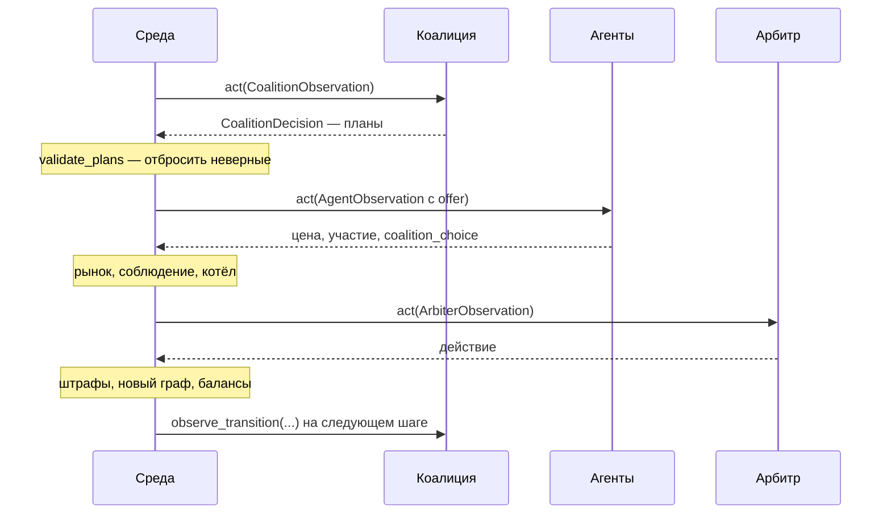

# Разбор 02 — Как коалиция подключена к среде

> [Разбор 00 — Оглавление](README.md) · предыдущая: [Разбор 01 — Рынок и теория игр](01-market-and-game-theory.md) · следующая: [Разбор 03 — Настройки](03-settings.md)
> Здесь тоже нет нашего кода: это правила среды (`social_market_env`), которые наш код обязан соблюдать.

## 1. Роли и чёрные ящики

В игре три вида участников, каждый — отдельная программа за строгим «договором» (API):

| Роль | Договор | Что получает | Что возвращает |
|---|---|---|---|
| Агент | `MarketAgentAPI` | Своё наблюдение и предложение коалиции | Цену, участие, выбор плана, просьбу о связи |
| **Коалиция** | `CoalitionPolicyAPI` | **Весь граф** и рынок | **Планы** |
| Арбитр | `ArbiterAPI` | Только рынок | Штраф или стоимость связей |

Среда не знает, что внутри программ: правила, нейросеть или таблица. Она только вызывает методы. Наша работа — класс `AdaptiveCoalitionPolicy`, реализующий `CoalitionPolicyAPI`.

## 2. Порядок шага



Важная деталь: **коалиция действует первой**. Она не знает, что сделают агенты на этом шаге, и узнаёт исход только на следующем.

## 3. Что видит коалиция: `CoalitionObservation`

Примеры в таблице описывают одну ситуацию: идёт 13-й шаг, агент 7 уже выбыл, у агента 9 долг.

| Поле | Тип | Смысл | Пример |
|---|---|---|---|
| `step` | число | Номер шага, с 0 | `12` |
| `active_agents` | кортеж | Кто ещё в игре | `(0, 1, 2, 3, 4, 5, 6, 8, 9, 10, 11)` — агента 7 нет, он выбыл |
| `restricted` | кортеж | У кого отрицательный резерв: их нельзя звать в план | `(9,)` |
| `costs` | словарь | Себестоимости активных | `{0: 19.46, 1: 16.89, 2: 15.29, …}` |
| `balances` | словарь | Резервы | `{0: 1843.2, 1: 2210.5, 9: -35.0, …}` — у агента 9 минус, поэтому он в `restricted` |
| `edges` | словарь пара → $H_{ij}$ | Текущие связи с памятью кооперации | `{(0, 1): 0.67, (1, 2): 0.2, (2, 5): -0.2, …}` — пара 0–1 часто соблюдала вместе, в паре 2–5 кто-то предавал. Пары без связи в словаре нет |
| `link_costs` | словарь пара → $c_{ij}$ | Стоимость связей, **след действий арбитра** | `{(0, 1): 0.0, (0, 2): 5.0, …}` — арбитр поднял стоимость связи 0–2. Здесь все пары, в том числе без связи и с выбывшими |
| `last_prices` | словарь | Цены прошлого шага | `{0: 27.4, 1: 26.9, 2: 24.1, …}` — только те, кто торговал |
| `last_profits` | словарь | Что каждый **получил** на прошлом шаге: после котла, штрафов и платы за связи | `{0: 71.3, 1: 68.0, 9: -50.0, …}` — агента 9 оштрафовали |
| `compliance_history` | словарь | По каждому агенту: как он обошёлся с прошлыми планами | `{0: (ComplianceRecord(step=10, plan_id=0, complied=True), ComplianceRecord(step=11, plan_id=0, complied=True)), 2: (ComplianceRecord(step=11, plan_id=0, complied=False),), …}` — агент 0 дважды соблюдал план 0, агент 2 на прошлом шаге нарушил |

Числа в примерах условные, но формат точно как в коде. Себестоимости — настоящие для seed 0.

Коалиции видно больше всех, но не всё. Нет прямых данных о штрафах, нет действий агентов со связями, нет длины эпизода. Часть из этого приходится восстанавливать (часть 09) или передавать через настройки (часть 03).

## 4. Что отправляет коалиция: `CoalitionPlan`

```python
CoalitionPlan(
    plan_id=0,
    members=(1, 2, 5),
    recommended_prices={1: 27.1, 2: 27.4, 5: 26.8},
    payout_weights={1: 0.35, 2: 0.30, 5: 0.35},
)
```

Решение `CoalitionDecision` — кортеж таких планов.

### 4.1. Правила проверки: `validate_plans`

Среда проверяет каждый план по порядку и отбрасывает неверные:

| Правило | Почему |
|---|---|
| `plan_id` уникален | Агенты выбирают план по номеру |
| Не меньше двух **разных** участников | Коалиция из одного бессмысленна |
| Все участники активны и не `restricted` | Выбывшие не торгуют, должники ограничены |
| Не пересекается с уже принятыми планами | Агент не может быть в двух коалициях |
| Цены и веса заданы ровно для участников | |
| Веса неотрицательны, сумма 1 ± $10^{-6}$ | Это доли котла |
| Цены в $[p_{\min},p_{\max}]$ | |
| **Участники связны по рёбрам между собой** | Договариваться можно только по связям |

Последнее правило — самое тонкое. Группа $\{1,2,3\}$ с рёбрами 1–2 и 2–3 связна. Группа $\{1,3\}$ при тех же рёбрах — нет: ребро идёт через агента 2, которого нет в группе. Поэтому кандидаты в части 05 строятся только из таких групп.

**Отклонённый план — потерянный шаг.** Поэтому наша политика прогоняет свои планы через ту же проверку до отправки (часть 12).

## 5. Что видит агент

Каждый участник принятого плана получает `CoalitionOffer`: номер плана, состав, **свою** рекомендованную цену и **свой** вес. Чужих цен и весов он не видит.

Агент отвечает действием:

```python
AgentAction(price=27.1, participate=True, coalition_choice=0)
```

## 6. Соблюдение: кто как обошёлся с планом

Функция `assess_compliance` делит участников каждого плана на три группы:

| Категория | Условие |
|---|---|
| **Соблюдающий** (`complier`) | Вступил (`coalition_choice` = номер плана), вышел на рынок, цена отличается от рекомендованной не больше чем на 0.5 |
| **Предатель** (`defector`) | Вступил, но цена отличается больше чем на 0.5 |
| **Отказавшийся** (`refuser`) | Не вступил или не вышел на рынок |

Допуск 0.5 задан в конфиге как `compliance_tolerance`.

## 7. Котёл: как делятся деньги

Прибыль соблюдающих складывается в общий котёл и делится по весам, **перенормированным среди соблюдающих**:

$$\text{котёл}=\sum_{j\in\text{соблюд.}}\pi_j,\qquad \text{получено}_i=\frac{w_i}{\sum_{j\in\text{соблюд.}}w_j}\cdot\text{котёл}$$

Предатели и отказавшиеся оставляют себе свою рыночную прибыль.

**Пример.** План на троих, веса 0.5, 0.3, 0.2, прибыли 100, 50, 400. Агент 3 предал:

- котёл $=100+50=150$;
- агент 1 получает $150\cdot 0.5/0.8=93.75$;
- агент 2 получает $150\cdot 0.3/0.8=56.25$;
- агент 3 оставляет свои 400.

Сумма денег сохраняется: $93.75+56.25+400=550$.

**Важно:** делится весь котёл, а не только дополнительный доход. Поэтому вес — это доля всего заработка группы, и от него очень зависит, выгодно ли агенту оставаться (часть 08).

## 8. Что ещё делает среда после шага

| Механизм | Что происходит | Значение для коалиции |
|---|---|---|
| Память $H_{ij}$ | $H\leftarrow H+0.2\,(\text{сигнал}-H)$. Сигнал +1 для пары соблюдавших вместе, −1 для предателя с партнёрами | Соблюдение укрепляет связи |
| Отказ | Сигнала нет вовсе | **Отказ с демпингом безопаснее предательства**, это пришлось учесть самим (часть 09) |
| Штраф | Целиком на одного агента, котёл его не делит | Нужна страховка (часть 08) |
| Вредность | План вреден, если SW ниже, чем при ценах Нэша у его соблюдающих, больше чем на 5 % | Скрытая разметка для оценки арбитра |
| Новый граф | По логиту из части 01 | Группа может распасться |

## 9. Обратная связь: `observe_transition`

После шага среда **не сразу** сообщает коалиции результат. `TransitionBuffer` держит переход до следующего наблюдения той же роли и затем вызывает:

```python
observe_transition(observation=..., action=..., reward=..., next_observation=..., done=...)
```

`reward` от среды — сумма «получено минус штрафы» всех соблюдающих по всем планам. Это одно число на все планы, поэтому для анализа его мало. Наш код восстанавливает подробности сам (часть 09).

На последнем шаге эпизода `next_observation=None` и `done=True`.

## 10. Как наш код попадает в среду

Через YAML-конфиг эксперимента:

```yaml
coalitions:
  policy:
    impl: "coalition_policy:AdaptiveCoalitionPolicy"
    kwargs: {structure: adaptive, payout: myerson, price_level: moderate}
```

`impl` — где лежит класс, `kwargs` — аргументы конструктора. Секцию `market` среда передаёт сама, если у конструктора есть параметр `market`. Всё остальное, например длину эпизода `horizon`, нужно передать явно: в наблюдении этого нет.

## Итог части

| Правило среды | Как на него ответил наш код |
|---|---|
| Коалиция ходит первой и не знает реакции | Память и прогнозы: части 09, 10 |
| Планы должны быть связны | Кандидаты только из связных групп: часть 05 |
| Отклонённый план — потерянный шаг | Самопроверка перед отправкой: часть 12 |
| Делится весь котёл | Веса считаются по вкладу: часть 08 |
| Отказ не наказывается средой | Своя категория «демпинг»: часть 09 |
| Награда — одно число | Восстановление исхода: часть 09 |
