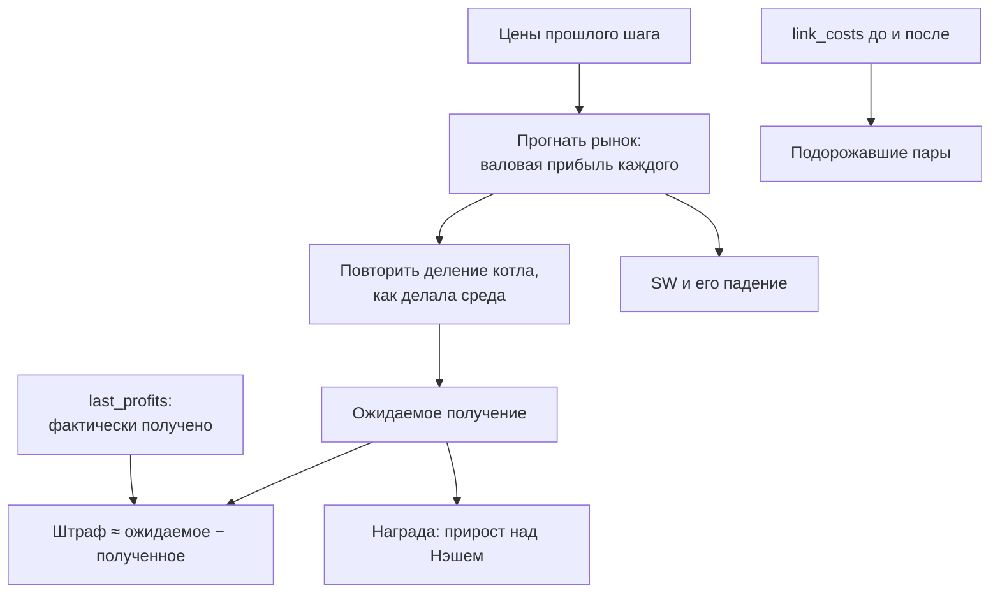

# Разбор 09 — Восстановление исхода

> [Разбор 00 — Оглавление](README.md) · предыдущая: [Разбор 08 — Деление прибыли](08-payouts.md) · следующая: [Разбор 10 — Убеждения](10-beliefs.md)
> Файл: `src/coalition_policy/rewards.py`, 152 строки.

## Зачем нужен

Чтобы учиться на опыте, политике надо знать, что произошло на прошлом шаге: кто соблюдал, кто обманул, штрафовал ли арбитр. Но среда сообщает **одно число** — суммарный доход соблюдавших по всем планам (часть 02, раздел 9).

Это как если бы после футбольного матча сказали только «команда набрала 3 очка», не уточнив, кто забил, кто получил карточку и с кем играли. Поэтому модуль **восстанавливает** подробности из того, что видно в следующем наблюдении.

## Что видно в следующем наблюдении

| Поле | Что из него извлекается |
|---|---|
| `compliance_history` | Кто соблюдал каждый план |
| `last_prices` | Кто продал дешевле плана |
| `last_profits` | Сколько каждый получил на самом деле. По разнице с ожидаемым — штрафы |
| `link_costs` | Подорожавшие связи — след действий арбитра |

## Результат: две структуры данных

### `PlanResult` (строки 24–39)

Как участники обошлись с одним планом. Три категории **наши**, они не совпадают с категориями среды:

| Наша категория | Условие | Категории среды |
|---|---|---|
| `compliers` — соблюдали | Запись в истории: соблюдал | complier |
| `undercutters` — сбили цену | Не соблюдал **и** продал дешевле рекомендации больше чем на допуск | defector **или** refuser |
| `absent` — не участвовали | Не соблюдал, но и не сбивал цену | refuser или defector с ценой выше плана |

**Почему так.** Среда наказывает в памяти $H_{ij}$ только предателей: тех, кто вступил и обманул. Отказавшийся, который демпингует, не наказан ничем. Но вред плану одинаковый: он отбирает покупателей у соблюдающих. Настоящий агент команды `AskarovAgent` всегда именно отказывается. Если бы политика смотрела только на категории среды, она не заметила бы ни одного нарушения.

### `StepOutcome` (строки 42–70)

| Поле | Смысл |
|---|---|
| `step` | Номер шага |
| `plans` | Результаты по планам |
| `fines` | Оценка штрафов по агентам |
| `raised_pairs` | Пары, стоимость связи которых выросла |
| `welfare_gap` | Падение SW относительно конкуренции |
| `reward` | Прирост соблюдавших над Нэшем, делённый на 100 |

И два вычисляемых свойства:

$$\text{compliance}=\frac{\sum_{\text{планы}}|\text{соблюдавшие}|}{\sum_{\text{планы}}|\text{участники}|},\qquad \text{arbiter\_reacted}=\text{есть подорожавшие связи или штрафы}$$

## Алгоритм `restore_outcome` (строки 73–111)

### Шаг 1. Классификация участников: `_plan_result` (строки 114–132)

Для каждого участника плана берётся **последняя** запись в его истории соблюдения. Агент за шаг может быть максимум в одном плане, поэтому последняя запись относится именно к этому плану. Если запись с нужным шагом и «соблюдал» — он соблюдал. Иначе смотрим на его цену.

### Шаг 2. Повтор деления котла: `_pool_shares` (строки 135–143)

Политика знает цены и себестоимости, значит, может сама прогнать рынок и повторить расчёт среды:

$$\widehat{\text{получено}}_i=\frac{w_i}{\sum_{j\in\text{соблюд.}}w_j}\sum_{j\in\text{соблюд.}}\pi_j$$

Для несоблюдавших ожидаемое получение — их валовая прибыль.

### Шаг 3. Штрафы: `_fines` (строки 146–148)

Среда вычитает из дохода штраф и плату за новые связи:

$$\text{last\_profit}_i=\text{получено}_i-\text{штраф}_i-\text{плата за связи}_i$$

Поэтому

$$\widehat{\text{штраф}}_i=\widehat{\text{получено}}_i-\text{last\_profit}_i$$

Разницы меньше `MIN_FINE = 1` отбрасываются. Это погрешность расчёта или плата за связь: обычно она 0 или небольшая, а штраф арбитра не меньше 1.

**Пример** из теста `test_outcome_restores_fines_and_arbiter_traces`: котёл двоих делится 0.75 / 0.25, первый получил на 40 меньше положенного. Восстановленный штраф — ровно 40.

### Шаг 4. Следы арбитра: `_raised_pairs` (строки 151–152)

Пары, у которых `link_costs` в следующем наблюдении больше, чем в текущем.

### Шаг 5. Падение SW

$$\text{gap}=1-\frac{SW}{SW^*},\qquad SW=\frac{Q^2}{2B}$$

$Q$ берётся из прогона рынка, $SW^*$ — из равновесия Нэша (часть 04).

### Шаг 6. Награда

$$r=\frac{1}{100}\sum_{\text{планы}}\ \sum_{i\in\text{соблюд.}}\Bigl(\widehat{\text{получено}}_i-\widehat{\text{штраф}}_i-\pi_i^{N}\Bigr)$$

**Почему не награда среды.** Среда даёт весь доход соблюдавших. План, где все заработали ровно как при конкуренции, в награде среды выглядит большим успехом, а на деле бесполезен. Прирост над Нэшем отвечает на правильный вопрос: «насколько коалиция лучше её отсутствия».

## Кто использует результат

| Получатель | Что берёт |
|---|---|
| `TrustTracker` (часть 10) | Категории участников |
| `FineLedger` (часть 10) | Штрафы |
| `PriceLadder` (часть 07) | Соблюдение, реакцию арбитра, падение SW, знак награды |
| Бандит (часть 11) | Награду и подорожавшие связи |

## Ограничения

- **Последний шаг эпизода не восстанавливается**: следующего наблюдения нет.
- Штраф отделяется от платы за связи только приблизительно.
- Предполагается, что вышли на рынок все, кто есть в `last_prices`. Агент, не вышедший на рынок, попадает в «не участвовал».
- Средняя цена и SW считаются по тем, кто торговал, как и в среде.
