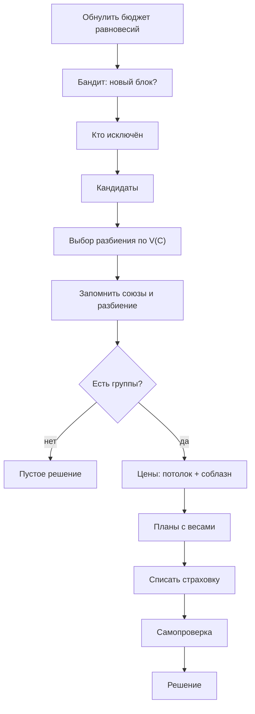
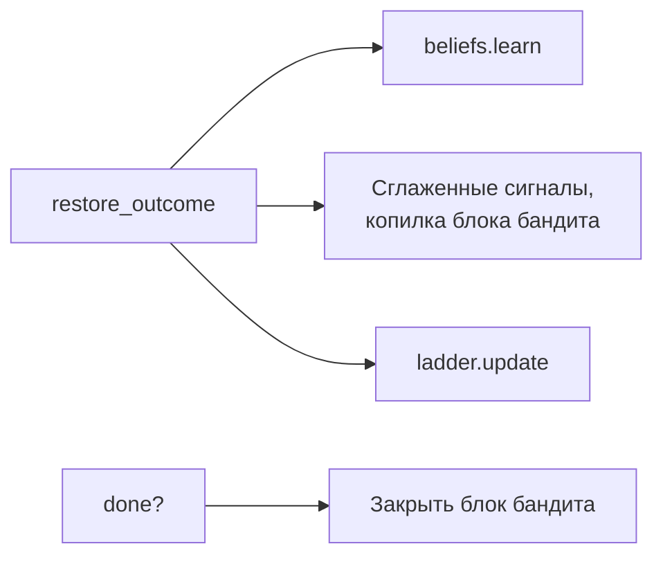

# Разбор 12 — Сборка: `policy.py`

> [Разбор 00 — Оглавление](README.md) · предыдущая: [Разбор 11 — Обучение](11-learning.md) · следующая: [Разбор 13 — Тестовые агенты](13-test-agents.md)
> Файл: `src/coalition_policy/policy.py`, 333 строки. Класс `AdaptiveCoalitionPolicy`.

## Зачем нужен

Все предыдущие модули — инструменты: каждый решает одну задачу. `policy.py` — **дирижёр**. Он почти ничего не считает сам, а вызывает инструменты в правильном порядке и передаёт результаты от одного к другому.

Это паттерн **«фасад»**: среда видит один простой класс с тремя методами, а за ним скрыты десять модулей.

## Три метода договора

| Метод | Когда вызывает среда | Что делает |
|---|---|---|
| `reset(seed, training)` | Перед эпизодом | Стирает память эпизода |
| `act(observation)` | В начале каждого шага | Возвращает планы |
| `observe_transition(...)` | На следующем шаге | Учится на исходе |

## Что хранится и сколько живёт

| Объект | Живёт | Создаётся |
|---|---|---|
| `settings` | Всю жизнь политики | `__init__` |
| `oracle` — кэш равновесий (часть 04) | Всю жизнь: кэш полезен между эпизодами | `__init__` |
| `learner` — бандит (часть 11) | Всю жизнь: это единственное, что учится между эпизодами | `__init__` |
| `beliefs` — доверие и штрафы (часть 10) | Один эпизод | `reset` |
| `ladder` — лестница цены (часть 07) | Один эпизод | `reset` |
| `_previous` — прошлое разбиение | Один эпизод | `reset` |
| `_plan_ids`, `_unions` | Один эпизод | `reset` |

### `__init__` (строки 46–66)

Принимает:

- `market` — параметры рынка, среда подставляет сама;
- `network` — параметры сети для модели выживания связей;
- `compliance_tolerance` — допуск соблюдения, 0.5;
- `checkpoint_path` — путь к обученному бандиту;
- остальное — в `PolicySettings` (часть 03). Неизвестное имя вызовет ошибку.

## Метод `act`: один шаг политики

Построчно (строки 86–110):

| Строка | Действие | Часть |
|---|---|---|
| 88 | Бюджет новых равновесий на шаг = 2 | см. ниже |
| 89 | `_pull_lever`: если начался новый блок, бандит выбирает потолок | 11 |
| 90 | Исключённые агенты | 10 |
| 91–93 | Кандидаты без исключённых | 05 |
| 94–99 | Разбиение с оценкой `_score` | 06 |
| 100 | Запомнить, из каких прошлых групп собраны новые | 08 |
| 102 | `last_report` для экспериментов | — |
| 105 | Итоговые цены | 07 |
| 106 | План на каждую группу | 08 |
| 107 | Списать страховку один раз | 10 |
| 110 | Проверить планы средой | 02 |

## Оценка группы: `_group_value` (строки 251–260)

Формула из плана, раздел 4.3, — дисконтированная версия $\Delta_C$ из ТЗ:

$$V(C)=\frac{\rho(C)\cdot\text{прирост}(C)-\hat F(C)}{1-\gamma\,s(C)}$$

| Символ | Смысл | Откуда |
|---|---|---|
| $\text{прирост}(C)$ | Насколько участники заработают больше Нэша при ценах под потолком | `oracle.gain`, часть 04 |
| $\rho(C)$ | Ожидаемая доля соблюдения: среднее доверие | часть 10 |
| $\hat F(C)$ | Ожидаемые штрафы за шаг | часть 10 |
| $s(C)$ | Вероятность, что группа останется связной | часть 10 |
| $\gamma$ | Вес будущего, 0.5 | `discount` |

### Откуда знаменатель

Если группа каждый шаг приносит $g$ и доживает до следующего шага с вероятностью $s$, ожидаемый поток дохода:

$$g+\gamma s\,g+(\gamma s)^2g+\dots=\frac{g}{1-\gamma s}$$

Надёжная группа ($s\approx1$) стоит до $1/(1-0.5)=2$ шагов дохода, ненадёжная ($s\approx0$) — один шаг.

### Почему $\gamma=0.5$, а не 0.9

При $\gamma=0.95$ знаменатель для надёжной группы был 0.05, то есть множитель 20, а для чуть менее надёжной — 7. Оценка стала сильно предпочитать мелкие группы: у них меньше рёбер, и вероятность сохранить их все выше. Но формула считает потерю связности **концом** коалиции, а это неправда: группа соберётся заново из оставшихся. После перехода на 0.5 фиксированный режим вернулся с 63.3 к 68.3.

**Пример.** Прирост 300, доверие 0.9, штрафов нет, $s=0.95$:

$$V=\frac{0.9\cdot300}{1-0.5\cdot0.95}=\frac{270}{0.525}=514$$

## Оценка разбиения и бюджет: `_score` (строки 242–249)

Оценка разбиения — сумма $V(C)$ его групп. Цены берутся **с учётом всех групп сразу**, поэтому внешние эффекты между планами внутри оценки.

**Бюджет равновесий.** Каждое новое разбиение требует нового равновесия, 10–80 мс. Профилировщик показал, что именно они давали пики времени `act` до 490 мс. Поэтому за шаг можно посчитать не больше двух новых. Уже посчитанные бесплатны. Если бюджет исчерпан, непосчитанное разбиение получает $-\infty$ и проигрывает.

Бюджет — число, а не время: ограничение по времени зависело бы от загрузки компьютера, и одинаковые прогоны давали бы разный результат.

## Цены: `_path`, `_capped_prices`, `_final_prices` (строки 197–240)

Три уровня, от дешёвого к точному:

| Метод | Что делает | Для чего |
|---|---|---|
| `_path` | Нэш, цель (равновесие разбиения), участники, $\lambda_{\max}$ по потолку SW | Общая заготовка |
| `_capped_prices` | Цены при $\lambda_{\max}$ | Оценка разбиений: быстро |
| `_final_prices` | Бисекция по ограничению на соблазн | Только для выбранного разбиения: дорого |

Ограничение на соблазн проверяется только для победителя, потому что каждая проверка требует наилучших ответов всех участников.

Детали `_final_prices`:

1. При `pricing='fixed'` — просто цены под потолком: режим этапа 1.
2. Веса считаются **один раз** при верхней цене: пересчёт на каждом шаге бисекции стоил бы слишком дорого.
3. Будущий вес каждого участника — конечная сумма с терпеливостью $0.9\cdot\text{доверие}$ (часть 07).
4. Бисекция находит долю пути, `ic_share` в отчёте показывает, насколько ограничение срезало цену.

`_allowed_gap` (строки 192–195): при фиксированной цене — уровень из настроек, при адаптивной — минимум из лестницы и потолка бандита.

## Планы и веса (строки 262–305)

- `_plan`: участники, их цены, веса.
- `_plan_id`: **стабильный номер группы** на эпизод. Одна и та же группа получает один номер, поэтому по истории соблюдения видно, как агент вёл себя именно в ней.
- `_weights`: при `equal` или группе больше 14 — поровну. Иначе таблица игры $v_\ell$ и нужная схема (часть 08), для гибрида со страховкой.
- `_remember_unions`, `_blocks`: союзы для Оуэна. Запоминаются **при первом появлении** группы как её пересечения с прошлыми группами размером от двух. Остальные участники — союзы из одного.

## Самопроверка: `_validated` (строки 313–325)

Перед отправкой планы проверяются **той же функцией, что и в среде**, `validate_plans`. Если что-то отклонено, политика падает с ошибкой.

Это сознательно. Отклонённый план — молча потерянный шаг, и его трудно заметить в результатах. Ошибка сразу показывает баг в нашем коде. За всё время экспериментов отклонений не было ни одного.

## `observe_transition`: обучение на исходе (строки 112–139)

Убеждения обновляются и при `training=False`. Это не обучение, а **память внутри эпизода**: при оценке политика тоже должна помнить, кто её обманул. Обучение бандита идёт только при `training=True`.

## Бандит в политике (строки 141–190)

| Метод | Что делает |
|---|---|
| `_pull_lever` | В начале каждого блока закрыть прошлый и выбрать вариант. Каждый шаг не давать лестнице подняться выше потолка варианта: иначе при смене варианта цена прыгнула бы |
| `_close_block` | Обновить бандита средней наградой блока |
| `_remember_signals` | Сглаженные давление арбитра и соблюдение $0.8x+0.2x_{\text{новое}}$, копилка награды |
| `_context` | 9 признаков ситуации, часть 11 |

## Диагностика: `_core_gap` (строки 327–333)

При `diagnostics=True` политика считает, какую долю котла недополучает самая недовольная подгруппа плана. Это показатель для таблиц экспериментов, на решения он не влияет. Тест `test_diagnostics_do_not_change_decisions` это проверяет.

## Пример шага с числами

12 агентов, середина эпизода, лестница на уровне 6 %, без арбитра:

1. Исключённых нет. Граф связный, кандидаты: вся компонента и два сообщества по 6.
2. Упаковки: $\{$все 12$\}$ и $\{6, 6\}$. Обе охватывают всех. По крупности впереди группа из 12.
3. Оценка: для каждой упаковки равновесие разбиения (кэш), цены под потолком 6 %, $V$ по формуле. Пусть выиграли две группы по 6, потому что у них выше $s$.
4. Гистерезис: прошлое разбиение было тем же, значит, менять нечего.
5. Цены: $\lambda_{\max}$ по потолку, бисекция по соблазну. Пусть ограничение не мешает.
6. Веса: гибрид. Майерсон на игре запланированных цен, проекция на ядро, страховки нет.
7. Самопроверка, два плана отправлены.
8. На следующем шаге `observe_transition`: все соблюдали, прирост положительный, арбитра нет. Доверие растёт, лестница ×1.15 до 6.9 %.

## Ограничения

- Оценка разбиений идёт при ценах под потолком, без ограничения на соблазн: точные цены считаются только для победителя.
- Бюджет в 2 равновесия может не дать оценить хорошее, но новое разбиение. Оно будет оценено на следующих шагах, когда кэш заполнится.
- `last_report` перезаписывается каждый шаг и нужен только экспериментам.
