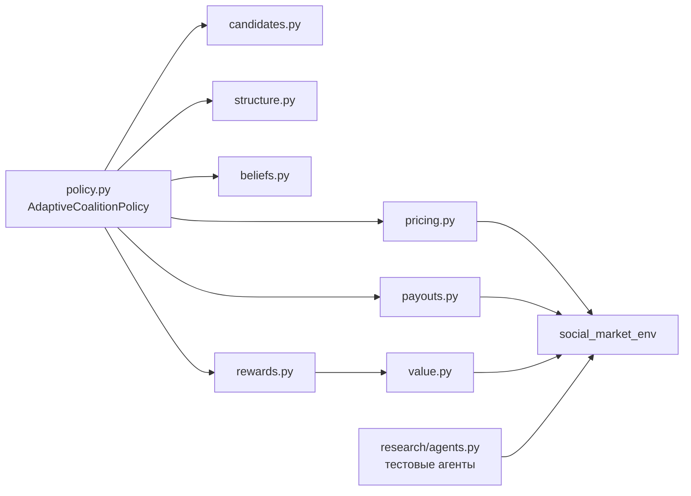
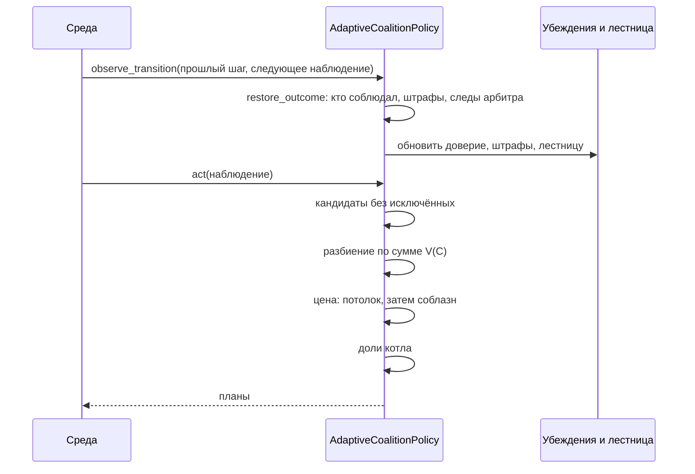

# Коалиция — журнал разработки

> Подробная запись того, что сделано в коде, почему и что показали проверки.
> План и обоснование: [Коалиция — план разработки](plan.md). Код: ветка `coalition` этого репозитория, пакеты `src/coalitions_badretdinov` и `src/coalitions_badretdinov/research`.

## Статус

| Этап | Состояние | Коммит |
|---|---|---|
| 0. Подготовка и сверка | Готово | — |
| 1. Правила | Готово | `29351f2` |
| 2. Устойчивость | Код и тесты готовы, 175 тестов проходят. Критерий готовности выполнен частично, см. «Итог этапа 2» | `9ef1082` |
| 3. Обучение | Бандит реализован, 184 теста проходят. Критерий не выполнен: выигрыша над лестницей нет | `27c6a8e` |
| 4. Адаптация | Не начат | — |
| 5. Эксперименты и защита | Эксперименты ТЗ проведены, кроме MARL-арбитра: [Коалиция — эксперименты ТЗ](experiments.md). Отчёт и слайды не сделаны | `3246a3b` |

## Как запустить

```bash
python -m pytest -q
python -m social_market_env.run src/coalitions_badretdinov/coalitions_badretdinov.yaml
python -m coalitions_badretdinov.research.compare --seeds 5 --arbiters observe --populations cartel patient90
```

Арбитр `preventive` и агенты `askarov` не входят в ветку `coalition`. Для их проверки пакеты нужно положить в `PYTHONPATH`:

- `preventive_arbiter` и `arbiter_lab` — `src/` репозитория [arbiter-research-and-design](https://github.com/ITMO-FPIN-SMA-2026/arbiter-research-and-design);
- `askarov_agent` — `src/` ветки [`agent-askarov`](https://github.com/ITMO-FPIN-SMA-2026/marl-market-env/tree/agent-askarov).

```bash
export PYTHONPATH="../arbiter-research-and-design/src:../askarov-agent/src"
```

Пути — пример, если эти копии лежат рядом с репозиторием. В Windows разделитель в `PYTHONPATH` — `;`.

## Структура кода



| Файл | Назначение | Этап |
|---|---|---|
| `settings.py` | Все настройки и режимы экспериментов | 1, 2 |
| `value.py` | Равновесия с кэшем | 1 |
| `candidates.py` | Связные группы-кандидаты, исключение нарушителей | 1, 2 |
| `structure.py` | Выбор разбиения с гистерезисом | 1 |
| `pricing.py` | Путь цены, потолок SW, соблазн, лестница | 1, 2 |
| `payouts.py` | Шепли, Майерсон, Оуэн, ядро, страховка | 1, 2 |
| `rewards.py` | Восстановление исхода шага | 2 |
| `beliefs.py` | Доверие, штрафы, выживаемость связей | 2 |
| `learner.py` | Контекстный бандит | 3 |
| `policy.py` | Сборка конвейера | 1, 2, 3 |
| `research/agents.py` | `PatientAgent`, `FlakyAgent` | 2 |
| `src/coalitions_badretdinov/research/compare.py` | Таблицы сравнения | 1, 2, 3 |
| `src/coalitions_badretdinov/research/train_bandit.py` | Обучение бандита | 3 |

## Шаг политики



## Этап 0. Сверка

- Окружение установлено по README среды, все 81 тест среды проходят.
- Таблицы плана для одинаковых издержек совпали с `coalition_equilibrium`, `best_response_price`, `find_harm`.
- Лазейка `find_harm` воспроизводится: 6 планов по 2 при цене 36.8 не помечаются, при 37.0 помечаются все.
- Поправки к плану записаны в его разделе 3.8: состав важнее размера, `tz_linear` разворачивает задачу, Майерсон среды слишком медленный.

## Этап 1. Правила

**Что сделано:**

- Кандидаты: компоненты связности, сообщества с учётом $H_{ij}$, прошлые группы.
- Разбиение: перебор непересекающихся наборов, оценка лучших через равновесие всего разбиения, гистерезис.
- Цена: путь от Нэша к равновесию разбиения с потолком падения SW.
- Доли: игра $v_\ell$ при ценах плана, быстрые Шепли и Майерсон на битовых масках.

**Игра $v_\ell(S)$:** совместная прибыль $S$, когда $S$ держит план, остальные участники плана возвращаются к Нэшу, другие планы не меняются. Снизу ограничена суммой прибылей Нэша.

**Результат:** см. статус в разделе 9 плана. Умеренная цена против `PreventiveArbiter` дала 68.4 против 56.1 у цены картеля. Было видно ограничение: уровень 7 % выбран ниже известного порога арбитра 8 %.

## Этап 2. Устойчивость

### Что показало изучение

| Наблюдение | Как проверено | Вывод для кода |
|---|---|---|
| Пики `act` дают только новые равновесия: 0.85 с из 0.92 с за эпизод | `cProfile` | Предел числа новых равновесий за шаг |
| `AskarovAgent` никогда не предаёт, а отказывается: на уровне `bold` отказались 748 из 748 | Прогон 4 уровней | Отказ с низкой ценой приравнять к предательству |
| Отказ в среде ничем не наказан: сигнал $H=-1$ получают только вступившие | Чтение `cooperation_signals` | Определять нарушение по цене из `last_prices` |
| Необученный `AskarovAgent` близорук: принимает план при $k\cdot w>1$, то есть только с долей выше средней | Чтение `_priors`, прогон | Ожидать частичное соблюдение. Сообщить команде агентов |

### Что реализовано

**`rewards.py`, восстановление исхода.** Среда отдаёт одно число на все планы. Из следующего наблюдения восстанавливаются:

- по планам: кто соблюдал, кто продал дешевле плана, кто просто не участвовал;
- штрафы: ожидаемая выплата минус `last_profits`, суммы меньше 1 отбрасываются, потому что смешиваются с платой за связи;
- следы арбитра: какие `link_costs` выросли;
- падение SW;
- награда: прирост соблюдавших над Нэшем.

Последний шаг эпизода не восстанавливается: следующего наблюдения нет.

**`beliefs.py`, убеждения.**

| Класс | Что хранит |
|---|---|
| `TrustTracker` | Бета-доверие с затуханием, априорно 0.8. Демпинг весит 1, неучастие 0.5 |
| `FineLedger` | Частота штрафов для $\mathbb{E}[F_C]$ и долг страховки перед соблюдавшими |
| `LinkSurvival` | Логит `evolve_edges` и вероятность сохранить самое надёжное остовное дерево |

Близость пары в наблюдении не видна, поэтому в логите она равна нулю. Просьбы агентов о связях тоже неизвестны.

**`pricing.py`, цена.** Цена — минимум из двух ограничений.

1. **Лестница `PriceLadder`.** Хранит допустимое падение SW и потолок:

| Исход шага | Действие |
|---|---|
| Арбитр отреагировал | Потолок = 0.85 × падение SW при реакции, уровень × 0.6 |
| Соблюдавшие заработали меньше Нэша | Уровень × 0.6 |
| Соблюдают не меньше 70 % | Уровень × 1.15 |
| Соблюдают меньше 70 %, но есть прирост | Уровень × 1.1 |

2. **Ограничение на соблазн.** Бисекция по доле пути цены, условие для каждого участника:

$$T_i(p)-\text{выплата}_i\le W_i\,(\text{выплата}_i-\pi_i^{Nash})$$

Здесь $W_i$ — сумма дисконтов оставшихся шагов при терпеливости $0.9\cdot\text{доверие}_i$. Горизонт конечный, поэтому к концу эпизода цена падает сама.

**`payouts.py`, деление.**

- Оуэн на масках: союзы — части прошлых групп, вошедшие в новую группу.
- Гибрид: Майерсон, затем проекция на ядро, затем надбавка страховки.
- Проекция закрывает самую сильную претензию подгруппы, сумма выплат не меняется. Если ядро пусто, возвращается лучший найденный вариант.
- Страховка: четверть долга за штраф соблюдавшему добавляется к его выплате на каждом шаге.

**`policy.py`, оценка группы** по разделу 4.3 плана:

$$\hat V(C)=\frac{\rho(C)\cdot\text{прирост}(C)-\hat F(C)}{1-0.5\,s(C)}$$

**`research/agents.py`, тестовые агенты.**

| Агент | Поведение |
|---|---|
| `PatientAgent(patience)` | Рациональный: предаёт, если разовый выигрыш больше будущей потери |
| `PatientAgent(refuse=True)` | То же, но отказывается, а не вступает: как `AskarovAgent` |
| `FlakyAgent(betray_rate)` | Предаёт случайно |

### Отступления от плана

| План | Сделано | Почему |
|---|---|---|
| $o_i$ — лучшее из Нэша и прибыли безбилетника | $o_i$ — Нэш | Разовую выгоду учитывает $T_i$, а затем лестница опускает цену группы, так что продолжение близко к Нэшу |
| AIMD, медленный подъём | Рост мультипликативный | От 2 % до картеля в 36 раз больше, прибавками не успеть за эпизод |
| Монте-Карло для больших групп | Равное деление при $n>14$ | В ЛР $N=12$, выборка не нужна |
| $\gamma$ в оценке $\hat V$ | 0.5 вместо 0.95 | Потеря связности не конец коалиции, см. ниже |

### История ошибок и исправлений

Первая версия этапа 2 проиграла этапу 1 почти на всех агентах. Сохраняю это здесь, потому что такие цепочки нужны для защиты: «изменение метода → поведение → награды».

| Версия | `cartel`, `preventive` | `flaky3`, без арбитра | `AskarovAgent` |
|---|---:|---:|---:|
| Этап 1, 7 % | 63.3 | 59.0 | 49.2 |
| Этап 2, первая | 57.6 | 51.4 | 43.9 |
| Этап 2, после трёх поправок | 68.7 | 71.1 | 45.1 |
| Этап 2, мягкое исключение | 68.7 | не перемерено | 47.3 |

1. **Лестница снижала цену при любом низком соблюдении.** Если часть держит цену и зарабатывает выше Нэша, снижать незачем. Теперь сигналом служит прирост над Нэшем.
2. **Исключение за первое нарушение было слишком жёстким.** Охват падал до 50 %. Перебор показал: порог доверия 0.3 почти не отличается от полного отказа от исключений и заметно лучше 0.5.
3. **Оценка с $\gamma=0.95$ слишком любила мелкие группы.** Она считала потерю связности концом коалиции. Заодно это просадило режим этапа 1: 63.3 вместо 68.4.
4. **Ошибка в тестовом агенте.** `PatientAgent` считал издержки соперников равными своим, и ошибка превышала весь выигрыш от плана: терпеливые агенты «предавали» около цены Нэша. Теперь он берёт средние издержки рынка. Это ошибка теста, а не политики.

### Проверка на подгонку

Тот же `PreventiveArbiter`, но с порогом 4 % вместо 8 %. 5 seeds, `CartelAgent`, сеть `random`:

| Политика | Прибыль | Вредные шаги | Охват | Рёбра |
|---|---:|---:|---:|---:|
| `components` | 54.1 | 10.0 % | 37.0 % | 1.8 |
| Этап 1, фиксированные 7 % | 56.6 | 33.8 % | 58.2 % | 9.0 |
| Фиксированные 15 % | 51.7 | 7.2 % | 39.8 % | 3.6 |
| **Адаптивная** | 55.7 | **0.9 %** | **97.2 %** | **23.7** |

При пороге 8 %: адаптивная 67.8, этап 1 — 68.3. **Лестница без знания порога почти догоняет настройку, подогнанную под этот порог, а при другом пороге сохраняет сеть**, которую фиксированный уровень разрушает.

### Схемы деления на разреженных графах

3 seeds, без арбитра, адаптивная цена. Прибыль на агента за шаг, в скобках нарушение ядра в процентах котла:

| Схема | `cartel`, path | `cartel`, star | `patient90`, path | `patient90`, star |
|---|---:|---:|---:|---:|
| Равная | 55.7 (15.1) | 47.1 (17.6) | 43.5 (17.3) | 43.4 (17.4) |
| Шепли | 133.8 (0) | 134.0 (0) | 103.7 (0) | 103.5 (0) |
| Майерсон | 133.8 (0) | 134.0 (0) | 103.6 (0) | 103.1 (0) |
| Оуэн | 65.8 (0) | 134.0 (0) | 79.3 (0) | 103.5 (0) |
| Гибрид | 133.8 (0) | 134.0 (0) | 103.6 (0) | 103.1 (0) |

**Выводы:**

- **Справедливое деление поднимает удерживаемую цену.** Равная доля даёт в 2.4–2.8 раза меньше прибыли даже у всегда соблюдающих `CartelAgent`. Причина: при равной доле дешёвый продавец получает мало, ограничение на соблазн срабатывает раньше, и политика снижает цену. Это главный результат этапа для вопроса о распределении наград.
- **Проекция на ядро здесь ничего не меняет.** Гибрид совпал с Майерсоном: на игре $v_\ell$ Майерсон уже лежит в ядре, нарушение 0. Похоже, эта игра близка к выпуклой, но это наблюдение, а не доказательство. Критерий плана «нарушения ядра снижены» выполнен только относительно равной доли.
- **Страховка в этих прогонах не проверена:** штрафов без арбитра нет.
- **Оуэн на цепочке заметно хуже** (65.8 против 133.8). Причину не выяснял: возможно, союзы из прошлых групп закрепляются при первом появлении группы и устаревают.
- Майерсон повышает охват относительно Шепли на `patient90`: 96.4 % против 87.2 % на path.

### Обученный `AskarovAgent`

10 эпизодов обучения агентов, затем оценка, 3 seeds, без арбитра:

| Политика | Прибыль | Падение SW | Соблюдение | Охват |
|---|---:|---:|---:|---:|
| Без коалиций | 43.1 | 0.3 % | — | — |
| `components` | 42.1 | −0.1 % | 0 % | 97.6 % |
| Этап 1 | 44.9 | 1.8 % | 17.4 % | 99.0 % |
| Адаптивная | 44.3 | 0.5 % | 20.7 % | 83.4 % |

Обучение не помогло: соблюдение снизилось примерно вдвое. Прирост над отсутствием коалиций около 3–4 %. **С реальным агентом команды коалиция почти бессильна.** 10 эпизодов мало, и таблица Q обучалась вместе с меняющейся политикой, поэтому это предварительный вывод. Нужна совместная работа с командой агентов.

### Вскрытые особенности среды и агентов

- **Рекомендованная цена работает как сигнал.** На `myopic` базовая политика получила 146.8 при 0.1 % соблюдения: все отказались, но отвечают на высокую рекомендацию высокой ценой. Это свойство `PatientAgent`, который считает, что остальные соблюдут. На защите так нельзя подавать успех baseline.
- **Запрос к команде агентов:** приор `AskarovAgent` близорукий и сравнивает выплату с разовым выигрышем. Без обучения он не примет почти никакой план.

### Итог этапа 2

Финальные настройки против `PreventiveArbiter`, 3 seeds, сеть `random`, прибыль на агента за шаг:

| Агенты | `components` | Этап 1, 7 % | Адаптивная |
|---|---:|---:|---:|
| `cartel` | 58.2 | 68.3 | 68.7 |
| `patient50` | 52.8 | 59.3 | 55.4 |
| `flaky3` | 54.6 | 63.3 | 54.9 |
| `askarov` | 43.8 | 50.2 | 47.3 |

Столбец `components` взят из более раннего прогона: baseline от настроек политики не зависит.

**Критерий плана «прирост против оппортуниста и `AskarovAgent`»:**

| Часть критерия | Результат |
|---|---|
| Лучше baseline на `AskarovAgent` | Да: 47.3 против 43.8, но с обученными агентами только 44.3 против 42.1 |
| Лучше baseline на рациональных агентах | Да, на `patient50` 55.4 против 52.8 |
| Лучше baseline на случайных предателях | На уровне шума: 54.9 против 54.6 |
| Лучше этапа 1 | **Нет.** Этап 1 выше на 3–8 единиц там, где знает порог арбитра |
| Нарушения ядра снижены | Только относительно равной доли. Гибрид не отличается от Майерсона |
| `act` меньше 200 мс | Обычно до 150 мс. В одном фоновом прогоне при двух параллельных задачах были пики 216–224 мс |

**Эффект памяти** (дополнено после коммита этапа 2). 3 seeds, сеть `random`, прибыль:

| Агенты | Без арбитра: с памятью | Без памяти | `preventive`: с памятью | Без памяти |
|---|---:|---:|---:|---:|
| `cartel` | 134.1 | 71.4 | 68.7 | 68.7 |
| `patient90` | 103.7 | 75.0 | 60.3 | 60.4 |
| `patient50` | 55.3 | 55.8 | 55.4 | 56.6 |
| `flaky3` | 71.2 | 63.4 | 54.9 | 55.1 |
| `askarov` | 47.3 | 49.4 | 47.3 | 49.4 |

Память работает не как «поимка предателей», а как **разрешение поднять цену**: растущее доверие ослабляет ограничение на соблазн. Поэтому она сильно помогает, когда цену ничто другое не держит, и бесполезна, когда потолок задаёт арбитр. На `AskarovAgent` она немного вредит: снижает охват с 98.8 % до 90.4 %.

**Что не проверено:**

- Страховка от штрафов: нужен прогон со штрафующим арбитром.
- Причина слабого результата Оуэна на цепочке.
- Малое число seeds: разницы в 1–3 единицы нельзя считать значимыми.

**Что передать на этап 3:** настройки лестницы (`start_gap`, `gap_growth`) и уровень цены — естественные рычаги бандита. Разрыв с этапом 1 — это цена незнания порога арбитра, и обучение на смеси арбитров должно его сокращать.

## Этап 3. Обучение

### Что сделано

- **`learner.py`:** контекстный бандит `LinearThompson`. Для каждого варианта своя байесовская линейная регрессия, при обучении выбор случайный по Thompson Sampling, при оценке жадный. Модель хранится в JSON.
- **Рычаг:** потолок падения SW на блок из 8 шагов. Варианты совпадают с уровнями цены: 5 %, 7 %, 15 %, картель. Значит, у бандита есть честные контрольные версии `cap-*`: те же варианты, зафиксированные на весь эпизод.
- **Контекст, 9 признаков:** константа, плотность графа, крупнейшая компонента, средний $H$, соблюдение, стоимость связей, давление арбитра, падение SW, остаток эпизода.
- **Награда блока:** прирост соблюдавших над Нэшем на агента минус штраф за долю подорожавших пар. Штраф нужен потому, что стоимость связи не затухает, а награда блока будущего не видит.
- **`src/coalitions_badretdinov/research/train_bandit.py`:** обучение на смеси 4 арбитров, 4 популяций, 4 топологий. 128 эпизодов, seeds от 100.
- **Модель:** `src/coalitions_badretdinov/research/bandit.json`. Настройка `learning='bandit'`, по умолчанию `off`.

### Результат

Оценка: seeds 2000–2004, которых не было в обучении, 5 seeds. Арбитр с порогом 6 % в обучение не входил. Прибыль на агента за шаг:

| Сценарий | `cap-cautious` | `cap-moderate` | `cap-bold` | `cap-cartel` | Бандит |
|---|---:|---:|---:|---:|---:|
| 6 %, `cartel` | 59.6 | 62.8 | 62.4 | 62.4 | 61.9 |
| 6 %, `patient90` | 50.0 | 50.7 | 50.6 | 50.6 | 50.3 |
| 6 %, `flaky3` | 50.5 | 51.4 | 51.3 | 51.3 | 50.9 |
| без арбитра, `cartel` | 59.6 | 66.9 | 88.3 | 136.7 | 135.8 |
| без арбитра, `patient90` | 50.0 | 52.3 | 60.1 | 75.0 | 74.8 |
| без арбитра, `flaky3` | 50.5 | 53.1 | 60.2 | 59.2 | 59.4 |

**Критерий плана «CMAB лучше лучшего фиксированного режима» не выполнен.** Бандит ни разу не обошёл лучший режим и ни в одном сценарии не дал значимой разницы с `cap-cartel`, то есть с обычной лестницей без ограничения. По правилам плана это допустимый исход, если показан честно.

**Почему.** Сначала я предположил, что бандит застрял на одном варианте. Подсчёт это опроверг: например, на `flaky3` против порога 6 % за 3 эпизода он выбрал cautious 6 раз, moderate 8, bold 3, cartel 7. Выбор меняется, но почти ни на что не влияет: **лестница и так обычно ниже потолка варианта**. Рычаг дублирует то, что уже делает лестница. Это объяснение подтверждается и тем, что `cap-bold` и `cap-cartel` против порога 6 % дали одинаковые числа, но отдельным экспериментом не проверялось.

**Вывод для проекта.** Настройка по умолчанию остаётся `learning='off'`: бандит усложняет политику без выигрыша. Для защиты это содержательный отрицательный результат: простое правило обратной связи оказалось достаточным для этого рычага.

**Что можно попробовать дальше:** рычаги, которых лестница не заменяет: режим структуры (`partial` или `adaptive`), схема деления, `gap_growth`. Перед этим стоит проверить контрольными фиксированными режимами, есть ли разница между вариантами вообще. Если разницы нет, бандиту нечему учиться.

**Ограничения.** 5 seeds, только сеть `random`, 128 эпизодов обучения, `AskarovAgent` в оценке не участвовал.
