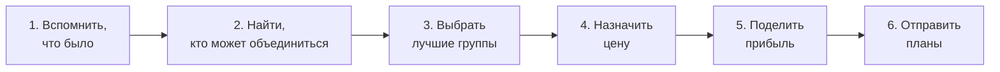
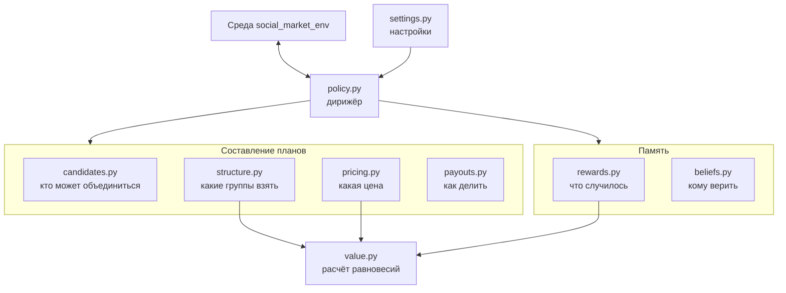

# Коалиция — простое объяснение

> Что сделано, простыми словами. Незнакомые термины — в [Коалиция — словарь](glossary.md). Подробный разбор каждого файла с теорией и формулами — в [Разбор 00 — Оглавление](walkthrough/README.md). Подробности и таблицы — в [Коалиция — журнал разработки](journal.md), замысел — в [Коалиция — план разработки](plan.md).
> Код: ветка [`coalition`](https://github.com/ITMO-FPIN-SMA-2026/marl-market-env/tree/coalition), коммит `9ef1082`.

## Что это вообще такое

Есть рынок: 12 продавцов на каждом шаге назначают цены. Покупатели идут к тем, кто дешевле. Если продавцы договорятся держать цену выше, заработают больше, но покупатели проиграют. Арбитр следит за рынком и мешает сговору.

**Наша задача — написать «посредника», который организует такие договорённости.** Он видит, кто с кем связан, и на каждом шаге предлагает продавцам план:

- кто объединяется;
- по какой цене продавать;
- кому какая доля общей прибыли.

Заставить он никого не может. Каждый продавец сам решает: согласиться, отказаться или согласиться и обмануть.

## Как это работает

Каждый шаг посредник делает одно и то же:



1. **Вспомнить, что было.** Кто сдержал слово, кто продал дешевле, штрафовал ли арбитр.
2. **Найти, кто может объединиться.** Объединяться можно только тем, кто связан в сети.
3. **Выбрать лучшие группы.** Сравниваются варианты разбиения на группы.
4. **Назначить цену.** Самую высокую, которую реально удержать.
5. **Поделить прибыль.** Так, чтобы каждому было выгодно остаться.
6. **Отправить планы** среде, а та покажет их продавцам.

## Три главные идеи

**1. Самая высокая цена — плохая цена.** Чем выше цена, тем выгоднее обмануть: предатель чуть снижает цену и забирает почти весь рынок. Высокую цену к тому же сразу замечает арбитр. Поэтому цена поднимается постепенно.

**2. Цена ищется на ощупь.** Посредник не знает, что считает опасным арбитр. Он делает как осторожный человек: всё хорошо — поднимает цену, арбитр отреагировал или группа в убытке — снижает и запоминает опасный уровень. Это называется лестницей цены.

**3. Справедливая делёжка помогает держать цену.** Если всем платить поровну, продавцам с низкой себестоимостью выгоднее уйти. Посреднику приходится снижать цену, чтобы их удержать. Делёжка по вкладу дала прибыль в 2.4–2.8 раза больше равной.

## Архитектура

Код разбит на небольшие модули, у каждого одна задача. `policy.py` — дирижёр: сам почти ничего не считает, а вызывает остальных по порядку.



Наш код общается со средой только через договор `CoalitionPolicyAPI`: среда вызывает `act` и `observe_transition`. Поэтому код среды менять не пришлось.

## Структура файлов

```text
marl-market-env/
├── src/
│   ├── social_market_env/                  среда команды, её код не менялся
│   └── coalitions_badretdinov/             НАША ПОЛИТИКА
│       ├── README.md                       результаты и автор
│       ├── coalitions_badretdinov.yaml     готовый эксперимент, пример подключения
│       ├── __init__.py
│       ├── policy.py
│       ├── settings.py
│       ├── candidates.py
│       ├── structure.py
│       ├── pricing.py
│       ├── payouts.py
│       ├── value.py
│       ├── beliefs.py
│       ├── rewards.py
│       ├── learner.py
│       ├── research/                       ВСПОМОГАТЕЛЬНОЕ
│       │   ├── agents.py                   тестовые противники
│       │   ├── compare.py                  таблицы сравнения
│       │   ├── train_bandit.py             обучение бандита
│       │   ├── tz_experiments.py           эксперименты ТЗ
│       │   └── bandit.json                 обученный бандит
│       └── docs/                           эта документация
└── tests/
    ├── test_coalitions_badretdinov_stage1.py   тесты этапа 1
    ├── test_coalitions_badretdinov_stage2.py   тесты этапа 2
    └── test_coalitions_badretdinov_stage3.py   тесты этапа 3
```

## Что делает каждый файл

### Политика: `src/coalitions_badretdinov/`

| Файл | Простыми словами | Главное внутри |
|---|---|---|
| `policy.py` | Дирижёр. Получает данные от среды, вызывает остальные модули, возвращает планы | `AdaptiveCoalitionPolicy` |
| `settings.py` | Все настройки в одном месте: режимы, уровни цены, пороги. Эксперименты меняют только их | `PolicySettings` |
| `candidates.py` | Находит группы, которые могут объединиться: они должны быть связаны в сети | `generate_candidates` |
| `structure.py` | Из групп собирает варианты разбиения и выбирает лучший. Не меняет состав без заметной выгоды | `select_partition` |
| `pricing.py` | Решает, какую цену рекомендовать: лестница и проверка, что обманывать невыгодно | `PriceLadder`, `incentive_holds` |
| `payouts.py` | Решает, кому какая доля: поровну, Шепли, Майерсон, Оуэн или гибрид | `payout_weights` |
| `value.py` | Считает, какими были бы цены в разных разбиениях, и запоминает результат, потому что расчёт медленный | `ValueOracle` |
| `beliefs.py` | Память об агентах: кому верить, кого штрафовали, какие связи скоро порвутся | `TrustTracker`, `FineLedger`, `LinkSurvival` |
| `rewards.py` | После шага разбирается, что произошло. Среда говорит мало, остальное приходится вычислять | `restore_outcome` |
| `learner.py` | Обучаемая часть: подбирает потолок цены по ситуации. По умолчанию выключена, выигрыша не дала | `LinearThompson` |
| `__init__.py` | Говорит Python, что импортировать из пакета | — |

### Остальное

| Файл | Простыми словами |
|---|---|
| `research/agents.py` | Тестовые продавцы. Стандартные всегда соблюдают план, поэтому написаны те, кто обманывает: расчётливый `PatientAgent` и случайный `FlakyAgent` |
| `src/coalitions_badretdinov/coalitions_badretdinov.yaml` | Настройки готового запуска: рынок, агенты, сеть, арбитр |
| `src/coalitions_badretdinov/research/compare.py` | Гоняет разные политики против разных агентов и арбитров и печатает таблицу |
| `src/coalitions_badretdinov/research/train_bandit.py` | Обучает бандита на смеси арбитров и агентов |
| `src/coalitions_badretdinov/research/bandit.json` | Обученная модель бандита |
| `tests/test_coalitions_badretdinov_stage3.py` | Проверяет бандита: учится, сохраняется, не учится при оценке |
| `tests/test_coalitions_badretdinov_stage1.py` | Проверяет этап 1: Шепли и Майерсон совпадают с лекцией и средой, в любой сети нет ошибочных планов |
| `tests/test_coalitions_badretdinov_stage2.py` | Проверяет этап 2: память, лестницу, ядро, поведение против предателей |

## Что уже работает

| Этап | Что появилось | Состояние |
|---|---|---|
| 0 | Подготовка, проверка плана на настоящем коде | Готово |
| 1 | Группы, разбиение, цена с постоянным уровнем, Шепли и Майерсон | Готово |
| 2 | Память, лестница цены, защита от предателей, Оуэн и гибрид | Код готов, цели достигнуты частично |
| 3 | Обучение: политика сама подбирает потолок цены | Сделано, но выигрыша нет: лестница справляется сама |
| 4 | Циклы адаптации с арбитром и агентами | Не начат |
| 5 | Итоговые эксперименты и защита | Не начат |

## Что получилось и что нет

**Получилось:**

- Умеренная цена против профилактического арбитра даёт больше цены картеля и сохраняет сеть.
- Лестница сама находит порог арбитра, хотя не знает его заранее.
- Планы ни разу не были отклонены средой, все 184 теста проходят.

**Не получилось или пока неизвестно:**

- С настоящим агентом команды `AskarovAgent` прирост мал: он редко соглашается, даже после обучения.
- Там, где порог арбитра известен заранее, фиксированная цена этапа 1 пока немного лучше.
- Гибридная делёжка не дала выигрыша по сравнению с Майерсоном.
- Обучение не дало выигрыша над простой лестницей.
- Память помогает только там, где цену не ограничивает арбитр: без арбитра у послушных агентов прибыль почти удваивается, а против профилактического арбитра разницы нет.

## Как запустить

Из корня репозитория, после установки по README:

```bash
python -m pytest -q
```

```bash
python -m social_market_env.run src/coalitions_badretdinov/coalitions_badretdinov.yaml
```

```bash
python -m coalitions_badretdinov.research.compare --seeds 3 --populations cartel patient90
```

Первая команда запускает тесты, вторая — готовый эксперимент (результат появится в папке `runs/`), третья печатает таблицу сравнения.
