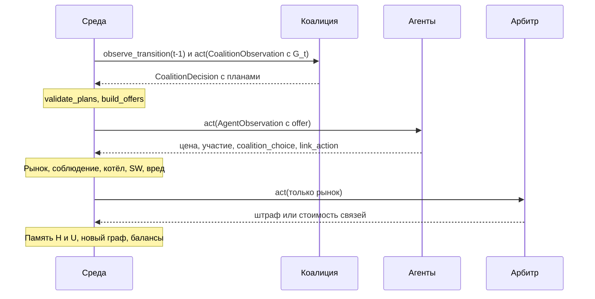
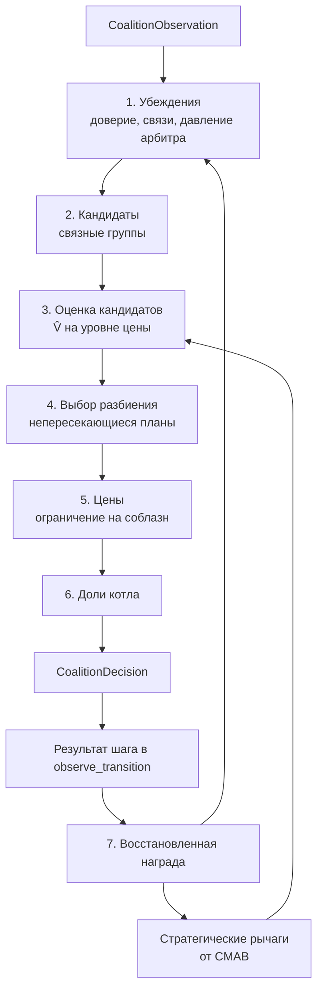
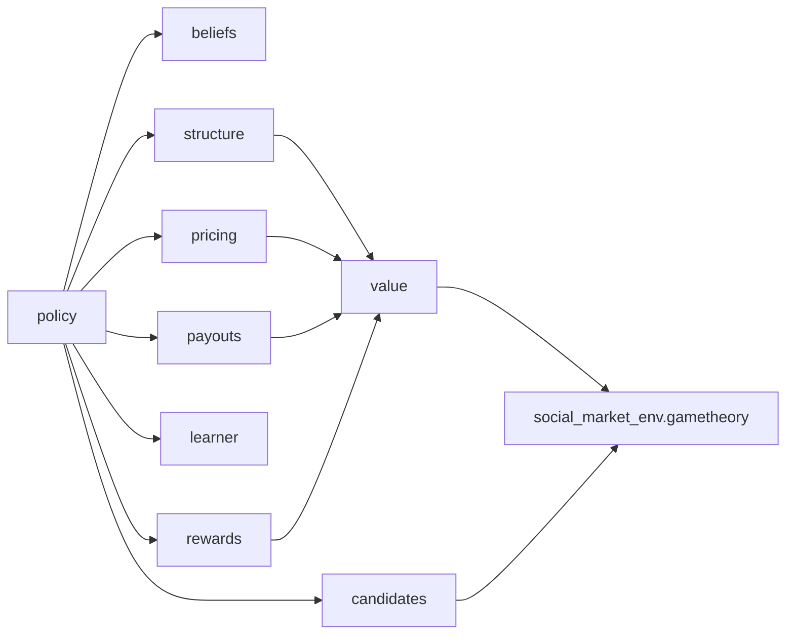

# Коалиция — план разработки

> Роль: Coalition / Network, ответственный — Антон Бадретдинов.
> Основа: ТЗ из [профиля организации](https://github.com/ITMO-FPIN-SMA-2026), код [marl-market-env](https://github.com/ITMO-FPIN-SMA-2026/marl-market-env) (`main`, `49255c7`), PR агента [#1](https://github.com/ITMO-FPIN-SMA-2026/marl-market-env/pull/1), репозиторий `arbiter-research-and-design`, `Шепли.docx`, книга Albrecht et al. по MARL.
> Составлено 2026-11-05.

> [!NOTE]
> **Это исходный план.** Он сохранён как обоснование решений. Что из него реализовано и чем закончилось, — в [журнале разработки](journal.md) и [экспериментах](experiments.md). Часть разделов, например про отдельный закрытый репозиторий, устарела.

> [!WARNING]
> **Старое описание среды устарело**
> Первое описание проекта относилось к `sma-environment` (`41dc871`). Рабочая среда теперь `marl-market-env` v2, и многие описанные там проблемы уже исправлены. Сравнение — в [2.3. Что изменилось относительно старой заметки](#23-что-изменилось-относительно-старой-заметки).

> [!TIP]
> **Сверка с кодом выполнена 2026-11-05**
> Числа раздела 3 считаны для $N=12$, $A=120$, $B=1$, $\tau=5$, logit-доли, $c=18.5$, и подтверждены настоящими `coalition_equilibrium`, `best_response_price` и `find_harm`: расхождения только в округлении. 81 тест среды проходит. Поправки по итогам сверки — в разделе [3.8. Что уточнила сверка](#38-что-уточнила-сверка).

## 0. Коротко

**Что делает коалиция.** Это один центральный «посредник», который видит весь граф $G_t$. На каждом шаге он предлагает агентам планы: кто вместе, по какой цене и с какими долями общего котла. Принуждать он не может: агент сам решает, вступить, соблюсти или предать.

**Главный вывод из экономики.** Предлагать цену максимального картеля — плохая стратегия. Такая цена даёт 215 на агента вместо 43.5, но предателю даёт 1342. Заодно она роняет SW на 72 % и сразу включает арбитра. Поэтому главная задача — выбирать **самую высокую цену, которую реально удержать** при текущем доверии и давлении арбитра.

**Что используется.** Гибрид из трёх уровней:

1. Теория игр: $v(C)$, Шепли, Майерсон, Оуэн, ядро, ограничение на соблазн предать.
2. Оценка состояния: доверие к агентам, выживаемость связей, давление арбитра.
3. Контекстный бандит (CMAB) над стратегическими рычагами. PPO и GNN — только опциональное улучшение: на бюджете 144 эпизодов PPO+GRU арбитра дал индекс 0.548 против 0.360 у эвристики.

**Как устроено.** Отдельный Python-пакет за контрактом `CoalitionPolicyAPI`, подключается через YAML. Конвейер шага: убеждения → кандидаты → выбор разбиения → цены → доли → планы.

**Как выполняется ЛР.** Политика параметризуется так, чтобы один код покрывал все требуемые режимы: топологии, структуры коалиций, статичную и меняющуюся сеть, арбитражи и циклы адаптации. Соответствие — в разделе 7.

## 1. Что требует ТЗ

| Требование ТЗ | Что нужно сделать | Состояние в среде |
|---|---|---|
| Формирование $\mathcal{C}_t$ на основе $G_t$ | Выбирать непересекающиеся связные коалиции | Есть только baseline по компонентам связности |
| Ценность $v(C,G_t)$: максимальный **дисконтированный** дополнительный доход | Считать с учётом будущего | `CharacteristicFunction` считает только один шаг |
| $\Delta_C = v - \sum V_i - \mathbb{E}[F_C]$ | Оценивать выгоду с учётом штрафов | `coalition_surplus` есть, ожидаемых штрафов нет |
| Деление: равное, Шепли, Майерсон, Оуэн (исторические суб-коалиции) | Все четыре плюс своё | Функции есть, Оуэн не подключён в `PAYOUT_SCHEMES` |
| Свой механизм деления для устойчивости | Гибрид с ядром и страховкой | Нет |
| $J_C=\sum\gamma^{t-1}[v-F_C]$ | Обучаемая политика | Нет |
| Координация цен | `recommended_prices` | Есть |
| Координация участия, партнёров, связей | Рекомендации агентам | **В контракте нет**, см. раздел 8 |
| Ответы на исследовательские вопросы 1–4 | Эксперименты | Нет |
| Личное улучшение каждого участника | Мотивация и результат | Нет |
| Защита: 2 слайда по коалициям | Улучшения и результаты | Нет |

## 2. Как коалиция встроена в среду

### 2.1. Место в шаге



### 2.2. Контракт

**Вход `CoalitionObservation`:** `active_agents`, `restricted`, `costs`, `balances`, `edges` (вес — память кооперации $H_{ij}\in[-1,1]$), `link_costs`, `last_prices`, `last_profits`, `compliance_history`.

**Выход `CoalitionPlan`:** `plan_id`, `members`, `recommended_prices`, `payout_weights`.

**Правила, которые определяют дизайн:**

- План отклоняется, если есть пересечения, неактивные или `restricted` участники, веса не дают 1, цена вне границ.
- Участники должны быть связаны **только через рёбра между собой**: без точки сочленения план развалится.
- Котёл делится только между теми, кто соблюдал: вступил и отклонился от цены не больше чем на 0.5.
- Предатель оставляет себе рыночную прибыль, а доля котла перераспределяется по весам оставшихся.
- Штраф целиком ложится на оштрафованного агента, котёл его не разделяет.
- В `edges` видна память кооперации. Сигнал $-1$ получают только те, кто вступил и предал. Тот, кто отказался и демпингует, штрафа в памяти не получает.
- Арбитр не видит граф и планы, но **коалиция видит действия арбитра**: `link_costs` показывает, какие пары он подозревает. Штрафы можно приблизительно восстановить: `last_profits` минус модельный доход.

### 2.3. Что изменилось относительно старой заметки

| Проблема в старой заметке | Сейчас в `marl-market-env` |
|---|---|
| Рынок «наоборот», Нэш выше монополии | По умолчанию `logit`, Нэш ≈ 24, картель ≈ 69. Формула ТЗ осталась как `tz_linear` |
| `SW = -средняя цена`, арбитру выгодно убить рынок | SW — излишек потребителей, цель — SW при Нэше, штраф ограничен `max_fine` |
| `link_action` без эффекта | Влияет на вероятность связи, `remove` разрывает связь, `add` стоит денег |
| Агент не знает свою коалицию | Есть `offer` с составом, ценой и долей |
| Бонус из ничего | Общий котёл, сумма денег сохраняется |
| Гранд-коалиция не считается вредной | Вред считается через контрфакт: участники плана по цене Нэша |
| Устаревший `next_observation` | `TransitionBuffer` отдаёт следующее наблюдение той же роли |
| Шепли, Майерсона, Оуэна нет | Есть в `gametheory/payouts.py` |

## 3. Экономика: что показали расчёты

### 3.1. Ценность резко растёт только у гранд-коалиции

Нэш: цена 23.93, прибыль 43.5 на агента, SW* = 4615.

| $k$ | Цена картеля | Цена остальных | Участник | Аутсайдер | $\Delta(C)$ за шаг | Падение SW | Вредная (5 %) |
|---:|---:|---:|---:|---:|---:|---:|:--:|
| 2 | 24.36 | 23.94 | 43.7 | 44.1 | 0.4 | 0.2 % | нет |
| 4 | 25.27 | 23.97 | 45.0 | 47.2 | 6.2 | 1.0 % | нет |
| 6 | 26.33 | 24.04 | 47.9 | 53.6 | 26.9 | 2.6 % | нет |
| 8 | 27.75 | 24.19 | 53.5 | 67.1 | 80.5 | 5.4 % | да |
| 10 | 30.24 | 24.64 | 66.0 | 105.8 | 225.4 | 10.9 % | да |
| 11 | 33.05 | 25.51 | 82.1 | 178.7 | 425.1 | 16.9 % | да |
| 12 | 69.25 | — | 214.6 | — | 2054.1 | 72.1 % | да |

Выводы:

- **Один аутсайдер ломает картель.** При $\tau=5$ покупатели резко уходят к дешёвому продавцу. Переход от 11 к 12 участникам увеличивает $\Delta$ почти в 5 раз, значит у каждого есть фактическое право вето.
- **Быть вне коалиции выгоднее, чем внутри**, при любом $k<12$. По критерию внутренней устойчивости проходят только $k=2,3$ с почти нулевой выгодой и $k=12$.
- **Одна частичная коалиция почти бесполезна.** При $k\le 6$ выгода не больше 27 за шаг.

### 3.2. Покрывающее разбиение лучше одной частичной коалиции

| Структура | Средняя цена | Прибыль на агента | Падение SW |
|---|---:|---|---:|
| Все поодиночке | 23.93 | 43.5 | 0 % |
| 6 пар | 24.44 | 47 | 1.1 % |
| 3 группы по 4 | 25.81 | 57 | 3.9 % |
| 2 группы по 6 | 27.98 | 73 | 8.3 % |
| Одна из 8, остальные одни | 26.57 | 54 внутри, 67 снаружи | 5.4 % |
| Гранд-коалиция | 69.25 | 215 | 72.1 % |

Когда каждый агент в какой-то группе, безбилетников нет. Для графов без связной гранд-коалиции цель — разбиение, покрывающее как можно больше агентов.

### 3.3. Чем выше цена, тем сильнее соблазн предать

Единая цена для всех 12. $T$ — прибыль предателя за один шаг. $\delta^*=(T-C)/(T-P)$ — минимальная терпеливость для удержания сговора при наказании возвратом к Нэшу.

| Падение SW | Цена | Прибыль на агента | Рост к Нэшу | $T$ | $\delta^*$ |
|---:|---:|---:|---:|---:|---:|
| 3 % | 25.38 | 54.3 | +25 % | 55.8 | 0.12 |
| 5 % | 26.36 | 61.3 | +41 % | 65.7 | 0.20 |
| 8 % | 27.85 | 71.8 | +65 % | 83.7 | 0.30 |
| 15 % | 31.43 | 95.4 | +120 % | 143.3 | 0.48 |
| 30 % | 39.62 | 141.5 | +226 % | 372.2 | 0.70 |
| 72 % (картель) | 69.25 | 214.6 | +393 % | 1342.2 | 0.87 |

Именно эта таблица делает цену главным рычагом политики. Умеренная цена даёт большую часть выгоды при малом соблазне и не привлекает арбитра.

### 3.4. Топология почти не меняет доли, но ограничивает размер

Вектор Майерсона на $v(k)$ из таблицы 3.1:

| Топология | Доступная ценность $v$ | Доли | Связных подмножеств |
|---|---:|---|---:|
| complete | 2575 | Все 8.3 % | 4095 |
| star | 2575 | Центр 11.4 %, листья 8.1 % | 2059 |
| path | 2575 | Концы 7.1 %, середина 8.9 % | 78 |
| inner (3×4) | 540 | Все 8.3 % | 45 |

Главный эффект топологии — **достижимый размер**, а не деление. В `inner_coalitions` гранд-коалиция недоступна, ценность падает почти в 5 раз. В `star` центр — единая точка отказа для арбитра. При разной себестоимости эффект долей станет сильнее: в гранд-картеле с издержками 15–22 валовая прибыль агентов варьируется от 146 до 312.

### 3.5. Шепли может быть неустойчивым

Пример из `Шепли.docx`: $\Phi=[19/6;\ 19/6;\ 22/6]$. Коалиция $\{1,3\}$ получает $41/6\approx 6.83$, но сама стоит 7. Значит, **вектор Шепли здесь не лежит в ядре**, и пара $\{1,3\}$ выгодно отделилась бы. Ядро при этом не пусто: например, $(3.5;\ 2.5;\ 4)$. Это прямое обоснование своего механизма, который ТЗ разрешает.

### 3.6. Штрафы слабы, удар по сети силён

Гранд-картель зарабатывает около 2575 за шаг, а максимальный штраф равен 100 одному агенту. Реальная угроза — стоимость связей, что совпадает с результатом команды арбитра: в меняющейся сети потеря SW упала с 59.9 % до 11.6 %.

Вероятность ребра при $H=1$, $U\approx0.9$, средней близости. Вклад $C_{ij}$ здесь практически нулевой, потому что в среде он считается по паре, а $\Delta$ пары почти равна нулю.

| Ситуация | Без просьб | С просьбой от обоих концов (`maintain` или `add`) |
|---|---:|---:|
| Сохранение, $c=0$ | 0.989 | ≈ 1 |
| Сохранение, $c=5$ | 0.366 | 0.921 |
| Сохранение, $c=10$ | 0.004 | 0.072 |
| Образование новой, $c=0$, $H=0$ | 0.018 | 0.269 |
| Образование новой, $c=5$, $H=0$ | ≈ 0 | 0.003 |

По умолчанию `link_cost_decay = 0`, поэтому такая стоимость не затухает: связь, уничтоженная арбитром, обратно почти не образуется. Просьба `maintain` от обоих концов особенно ценна при $c=5$. Значит, координация связей — реальный рычаг, но в контракте её пока нет.

### 3.7. Лазейка в определении вреда

Вред в `find_harm` проверяется **по каждому плану отдельно**, остальные планы в контрфакте остаются на своих ценах. Несколько мелких планов с одинаковой высокой ценой не будут считаться вредными:

| Планов | Максимальная цена без пометки «вредно» | Падение SW | Прибыль на агента |
|---|---:|---:|---:|
| 1 × 12 | 26.36 | 5.0 % | 61.4 |
| 2 × 6 | 28.67 | 9.6 % | 77.4 |
| 3 × 4 | 30.88 | 13.9 % | 91.9 |
| 6 × 2 | 36.89 | 25.2 % | 127.3 |

Это дефект метрики, а не удачная стратегия. Настоящий `find_harm` его подтвердил: например, 6 × 2 при цене 36.8 не помечается, при 37.0 помечаются все планы. Нужно передать команде среды, см. CR-5 в разделе 8.

### 3.8. Что уточнила сверка

**Разные издержки меняют вывод 3.1.** Издержки 15–22, seed 0, участники — первые $k$ агентов:

| $k$ | $\Delta(C)$ при разных издержках | При одинаковых | Падение SW |
|---:|---:|---:|---:|
| 2 | 2.2 | 0.3 | 0.2 % |
| 4 | 88.0 | 6.2 | 1.5 % |
| 6 | 69.7 | 26.8 | 3.0 % |
| 8 | 97.5 | 80.3 | 5.7 % |
| 12 | 2049.6 | 2053.9 | 71.9 % |

Группа выгодна и при малом размере, если в ней есть дешёвые продавцы: сбыт переходит к ним, а котёл делится. Значит, **важен состав, а не только размер**, и $\Delta$ не монотонна по $k$. Частичные коалиции надо оценивать по настоящим издержкам.

**`tz_linear` разворачивает задачу.** Нэш упирается в цену 100, любой картель снижает цену и поднимает SW, поэтому вреда нет. Гранд-коалиция даёт $\Delta=946$, $\delta^*=0.56$. Цены нельзя зашивать, а потолок незаметности в этом режиме не нужен.

**Скорость.** Одно равновесие занимает 10–80 мс. Майерсон для цепочки из 12 — 2.1 с, полный Шепли для 12 — порядка минут. Поэтому этап 1 считает доли на игре $v_\ell$ при запланированных ценах: это не требует равновесий и идёт векторно по битовым маскам.

**Определение игры $v_\ell$ для долей.** $v_\ell(S)$ — совместная прибыль $S$, когда $S$ держит план, остальные участники плана возвращаются к Нэшу, другие планы не меняются. Снизу она ограничена суммой прибылей Нэша: иначе при высокой цене у малых подмножеств ценность была бы около нуля.

**Размещение кода.** По решению Антона работа идёт в ветке `coalition` репозитория `marl-market-env`, пакет `src/coalitions_badretdinov`, как у `src/preventive_arbiter` и `src/askarov_agent`. Перед отправкой на GitHub нужно решить вопрос закрытости блока (раздел 5.1).

## 4. Как коалиция работает

### 4.1. Конвейер шага



### 4.2. Шаг на примере

1. Политика видит, что агент 5 на прошлом шаге вступил в план и продал дешевле. Его доверие падает, он исключается из плана на $L$ шагов.
2. Из оставшихся строятся кандидаты: прошлые планы, компоненты и кластеры по $H_{ij}$.
3. Бандит выбрал режим «умеренный, покрывающее разбиение, Майерсон».
4. Для каждого кандидата оценивается $\hat V$, и выбирается лучшее разбиение. Смена состава допускается, только если выгода больше порога: так $H_{ij}$ успевает накопиться.
5. Цена поднимается до предела, где соблазн предать ещё уравновешен будущим доходом и потолком незаметности.
6. Доли считаются на той же ценовой политике, по которой рассчитан котёл. Затем они корректируются так, чтобы никому не было выгоднее уйти.
7. После шага считается прирост над Нэшем, обновляются доверие, давление и бандит.

### 4.3. Оценка кандидата

Дисконтированная версия $\Delta_C$ из ТЗ:

$$\hat V(C,\ell)=\frac{\rho(C)\,\bigl[\mathrm{Pool}_\ell(C)-\sum_{i\in C}o_i\bigr]-\hat F(C)}{1-\gamma\, s(C)}$$

| Символ | Смысл | Откуда |
|---|---|---|
| $\mathrm{Pool}_\ell(C)$ | Котёл при уровне цены $\ell$ | Модель рынка |
| $o_i$ | Внешняя опция: лучшее из прибыли Нэша и прибыли безбилетника | Оракул ценности |
| $\rho(C)$ | Ожидаемое соблюдение | Доверие, бета-распределение |
| $\hat F(C)$ | Ожидаемые штрафы | Восстановленные штрафы |
| $s(C)$ | Вероятность сохранить связность | Модель `evolve_edges` по лучшему остовному дереву |

Сравнение с ТЗ: $v$ становится дисконтированной через $s(C)$, $\sum V_i$ — это $\sum o_i$, а $\mathbb{E}[F_C]$ — это $\hat F(C)$.

### 4.4. Цена

Для каждого участника цена должна проходить ограничение на соблазн:

$$T_i(p)-w_i\,\mathrm{Pool}(p)\ \le\ \frac{\delta}{1-\delta}\,\bigl[w_i\,\mathrm{Pool}(p)-o_i\bigr]$$

Итоговая цена выбирается так:

$$p^*=\min\bigl(p^{IC}(\delta_{\text{эфф}}),\ p^{\text{незаметности}},\ p^{\text{картеля}}\bigr)$$

- $\delta_{\text{эфф}}$ оценивается по истории соблюдения и падает к концу эпизода. В последних шагах сговор удержать трудно.
- Лестница цен работает как AIMD: медленный подъём после чистых шагов и резкое снижение после предательства или реакции арбитра.
- Потолок незаметности **оценивается, а не зашивается**: он следует за измеренным давлением арбитра. По ТЗ нельзя оптимизироваться под одну неизменную политику.
- Небольшой разброс цен по издержкам снижает узнаваемость: арбитр ищет похожие цены. Заодно это соответствует настоящему решению картеля, где цены идут от 67.3 до 70.8.

### 4.5. Деление котла

В среде делится весь котёл, а не только дополнительный доход. Поэтому веса считаются через сумму выплат:

$$w_i=\frac{x_i}{\sum_j x_j},\qquad x_i=o_i+\text{доля дополнительного дохода}$$

| Схема | Когда нужна |
|---|---|
| Равная | Контрольная база |
| Шепли | Вклад без учёта графа |
| Майерсон | Основная для разреженных графов: учитывает позицию в сети |
| Оуэн | План объединяет исторические суб-коалиции: блоки берутся из прошлых планов и кластеров $H_{ij}$ |
| **Гибрид (своя)** | Майерсон, спроецированный на ядро, плюс компенсация штрафов |

**Важная поправка.** Baseline считает доли по $v$ при цене картеля. Если план использует умеренную цену, доли нужно считать по игре $v_\ell$ на **той же** цене, иначе они не будут соответствовать реальному котлу.

**Гибрид в три шага:**

1. Базовый вектор: Майерсон на $v_\ell$.
2. Ядро: проекция на $x_i\ge o_i$ и $x(S)\ge v_\ell(S)$ по выборке опасных подмножеств $S$. Это закрывает случай из раздела 3.5.
3. Страховка: штраф ложится на одного агента, поэтому на следующих шагах его вес временно растёт. Так участника не вытолкнет из игры, а план не потеряет член.

### 4.6. Обучение

**Почему не сразу PPO.** Решение по составу комбинаторное, эпизоды короткие, награда шумная. Опыт арбитра показал слабость PPO на малом бюджете. Бандит над несколькими рычагами учится быстрее, а его результат легко объяснить на защите.

**Действие бандита** держится $K\approx5$ шагов, чтобы эффект успел проявиться:

| Рычаг | Варианты |
|---|---|
| Уровень цены | Осторожный, умеренный, смелый, картель |
| Структура | Покрывающее разбиение, крупнейшая группа, гранд-коалиция, пауза |
| Деление | Равное, Майерсон, Оуэн, гибрид |
| Терпимость к предателям | Длина исключения $L$ |

**Контекст:** плотность графа, доля крупнейшей компоненты, средний $H_{ij}$, уровень соблюдения, средняя и новая `link_costs`, оценка падения SW, частота штрафов, доля пройденного эпизода, доля `restricted`.

**Метод:** линейный Thompson Sampling или LinUCB на NumPy. Состояние сохраняется в JSON, как у агента Аскарова. При `training=False` веса заморожены.

**Награда.** Сырая `coalition_reward` не подходит: это весь доход соблюдавших, поэтому пустая политика получает 0, а любой план с прибылью по Нэшу выглядит успехом. Используется прирост над опцией:

$$r_t=\frac{1}{\text{scale}}\sum_{C}\sum_{i\in\text{compl}(C)}\bigl(\text{получено}_i-o_i\bigr)-\lambda_{\text{разрыв}}\cdot\text{потерянные связи}$$

Разбивка по планам восстанавливается из следующего наблюдения: `compliance_history` плюс `last_profits`.

**Опциональный следующий шаг.** GNN над рёбрами и узлами выдаёт оценки для кандидатов, обучение через PPO с централизованным критиком на `env.global_state()`. Запускать только если бандит упёрся в потолок и есть время.

## 5. Архитектура

### 5.1. Пакет

Отдельный закрытый репозиторий по примеру арбитра: `coalition-research-and-design`.

```text
src/coalitions_badretdinov/
  policy.py        # AdaptiveCoalitionPolicy: фасад контракта
  settings.py      # параметры, все режимы экспериментов
  beliefs.py       # TrustTracker, LinkSurvival, ArbiterPressure
  value.py         # ValueOracle: v(S | разбиение), o_i, T_i, кэш
  candidates.py    # генерация связных групп
  structure.py     # выбор разбиения с гистерезисом
  pricing.py       # лестница, IC, потолок незаметности
  payouts.py       # веса: схемы, ядро, страховка, игра v_l
  learner.py       # контекстный бандит, сохранение
  rewards.py       # восстановление наград и штрафов
  planning.py      # сборка планов и локальная проверка
src/coalitions_badretdinov/research/ # сценарии, тестовые агенты, отчёты
experiments/       # YAML всех режимов
tests/
```



### 5.2. Фасад

```python
class AdaptiveCoalitionPolicy(CoalitionPolicyAPI):
    def __init__(self, *, market=None, horizon=200, network_mode='evolving',
                 compliance_tolerance=0.5, settings=None, checkpoint_path=None): ...

    def reset(self, *, seed, training):
        self.training = training
        self.beliefs.reset()            # обученный бандит сохраняется между эпизодами

    def act(self, observation):
        self.beliefs.update(observation)
        lever = self.learner.current_lever(self.beliefs.context(observation))
        groups = generate_candidates(observation, self.beliefs, lever)
        partition = select_partition(groups, self.oracle, self.beliefs, lever)
        return build_decision(partition, observation, self.oracle, self.beliefs, lever)

    def observe_transition(self, *, observation, action, reward, next_observation, done):
        outcome = restore_outcome(observation, action, next_observation, self.oracle)
        self.beliefs.learn(outcome)
        if self.training:
            self.learner.update(outcome)
```

`market` среда подставит сама, остальные параметры передаются через `kwargs`, как у `PreventiveArbiter`. В наблюдении нет `horizon`, режима сети и допуска соблюдения.

### 5.3. Ключевые решения

| Решение | Почему |
|---|---|
| Гибрид вместо чистого RL | Есть точная модель рынка, RL нужен только там, где модели нет: реакция агентов и арбитра |
| Своя модель $v(S\mid\text{разбиение})$ | Среда считает $v$ при одиночках вокруг. Для разбиений и $o_i$ важны внешние эффекты, они здесь сильные (раздел 3.1) |
| Быстрый оракул | $2^{12}$ равновесий на сетке за шаг слишком дорого. Нужны решение условий первого порядка, кэш по составу и себестоимости, только связные подмножества, Монте-Карло для больших групп |
| Стабильные `plan_id` и гистерезис | $H_{ij}$ и связи растут только у постоянных партнёров |
| Рычаги, а не прямой выбор групп | Малое пространство действий, быстрое обучение |
| Режимы через параметры | Один код выполняет все эксперименты ТЗ |
| Локальная проверка плана | Отклонённый план — потерянный шаг, цель — 0 отклонений |

**Бюджет времени.** `act` не должен превышать 0.2 с при пределе среды 1 с. Любое исключение в нестрогом режиме превращается в пустое решение, поэтому внутри нужна безопасная деградация до простого плана.

### 5.4. Модули подробнее

| Модуль | Содержимое |
|---|---|
| `beliefs.TrustTracker` | Бета-распределение на агента с затуханием, различие отказа и предательства через `last_prices` |
| `beliefs.LinkSurvival` | Логит `evolve_edges` с конфигом сети, оценка близости пары по наблюдениям, остовное дерево с максимальной выживаемостью |
| `beliefs.ArbiterPressure` | Новые `link_costs`, восстановленные штрафы, оценка порога реакции |
| `candidates` | Прошлые планы, компоненты, $k$-ядра, кластеры по $H_{ij}$, рост от надёжного ядра, разбиение большой компоненты, удаление предателей с проверкой связности |
| `structure` | Упаковка множеств с максимальным весом перебором с отсечением (кандидатов мало), затем проверка нескольких лучших разбиений оракулом |

## 6. Режимы и базы для сравнения

| Режим | Настройки |
|---|---|
| `antagonism` | Без планов, совпадает с `NoCoalitions` |
| `partial` | Только группы меньше $N$ |
| `grand` | Только гранд-коалиция, если граф связный |
| `adaptive` | Полная политика |
| `payout` | `equal`, `shapley`, `myerson`, `owen`, `hybrid` |
| `pricing` | `cartel`, `fixed_level`, `ic` |
| `learning` | `off`, `bandit` |

**Контрольные базы:** `NoCoalitions`, `ConnectedComponentsCoalitions` с тремя схемами.

**Типы агентов для проверки:** `CartelAgent`, `BestResponseAgent`, `AskarovAgent`, плюс свои тестовые: оппортунист, который предаёт при большом $T$, и отказник.

## 7. Как выполняется задание

### 7.1. Обязательные эксперименты

| Эксперимент ТЗ | Настройка | Что показать |
|---|---|---|
| **Топология:** complete, star, path, inner | `network.topology`, `static` и `evolving` | Размер и срок жизни коалиций, $\Delta$, распределение долей, SW |
| **Структура:** антагонизм, частные, гранд | Режимы `antagonism`, `partial`, `grand` | Прибыль, дополнительная награда, устойчивость, граф связей |
| **Эволюция:** $G_t=G$ и $G_{t+1}=f(G_t,H_t)$ | `network.mode` | Динамика рёбер, $H_{ij}$, зависимость траектории от стартовой сети |
| **Арбитраж:** нет, жёсткая политика, MARL | `AlwaysObserve`, `ThresholdArbiter`, `PreventiveArbiter`, PPO арбитр | Накопленная прибыль, доход коалиций, SW |
| **Адаптация:** не менее 3 циклов | $\pi_A\to\pi_M'\to\pi_A'\to\pi_M''$ | Цепочки «метод → поведение → награды» |

Для адаптации бандит обучается на **смеси** арбитров, а не на одном. Это идея популяционного обучения из главы 9.9 книги и прямое требование ТЗ.

Протокол по примеру арбитра: 12 продавцов, 64 шага, отдельные seeds обучения, валидации и теста, минимум 10 тестовых seeds, интервалы bootstrap по целым seeds.

### 7.2. Исследовательские вопросы

| Вопрос | Как отвечаем |
|---|---|
| Как топология меняет распределение наград? | Майерсон и фактические выплаты по топологиям, неравенство, доля центра в звезде |
| Как вероятность коалиции зависит от установок и истории? | Логистическая оценка попадания пары в план по $z_{ij}$, $H_{ij}$, $U_{ij}$, `link_costs` |
| Когда коалиция устойчива? | Карта: цена × доверие × арбитр. Критерии $\delta^*$, ядро, внутренняя и внешняя устойчивость |
| Когда коалиция повышает или снижает SW? | Изменение SW к Нэшу по режимам и уровням цены |
| Вопрос об эффекте памяти | Сравнение с доверием и без него, $H_{ij}$ и окно истории |

Вопросы об обнаружении вредных коалиций и об эффективности арбитра ведёт команда арбитра, коалиция предоставляет для них стратегии-противников.

### 7.3. Метрики

| Группа | Метрики |
|---|---|
| Выгода | Суммарный $\Delta$, $J_C$, прибыль на агента, доля от выгоды картеля |
| Устойчивость | Соблюдение, предательства, срок жизни состава, сходство разбиений соседних шагов, нарушения ядра |
| Справедливость | Джини выплат, $\min_i(w_i\mathrm{Pool}-o_i)$ |
| Общество | SW, падение к SW*, шаги с вредными планами |
| Сеть | Плотность, размер компоненты, потерянные связи, `link_costs` |
| Качество | Отклонённые планы (цель 0), время `act`, ошибки |

### 7.4. Защита

**Слайд 1 — улучшения:** IC-цена вместо цены картеля, гибридное деление, доверие, CMAB.

**Слайд 2 — результаты:** прирост к `ConnectedComponentsCoalitions`, карта устойчивости, поведение против арбитров.

**Личное улучшение.** Для Антона — цена с ограничением на соблазн: мотивация в разделе 3.3. Для второго участника с третьей недели — гибридное деление: мотивация в разделе 3.5.

## 8. Запросы к команде среды

Всё реализуемо без правок среды, но с ними результат будет честнее.

| ID | Запрос | Зачем | Без него |
|---|---|---|---|
| CR-1 | Рекомендации связей в плане и в `CoalitionOffer` | ТЗ: координация связей | Агенты решают сами, у Аскарова уже есть `maintain` партнёрам |
| CR-2 | Рекомендация участия и выплаты неучаствующим | ТЗ: координация участия | Неучаствующий считается отказавшимся |
| CR-3 | Награда по планам в `observe_transition` | Точное распределение заслуг | Восстанавливаем, последний шаг эпизода теряется |
| CR-4 | $v(S\mid\text{разбиение})$ и Оуэн в baseline | Сравнимость команд | Держим в своём пакете |
| CR-5 | Вред считать совместно по всем планам | Закрыть лазейку 3.7 | Метрика занижает вред, сообщить обязательно |
| CR-6 | Отрицательный сигнал $H$ за отказ с демпингом | Сейчас отказ безопаснее предательства | Наказываем через доверие |
| CR-7 | Парный $C_{ij}$ заменить на вклад в реальную коалицию | Сейчас вклад почти нулевой (3.6) | Параметр `w_coop` бесполезен |
| CR-8 | Явные поля `last_fines` и `horizon` | Убрать приблизительную оценку | Восстанавливаем и передаём через `kwargs` |

## 9. План работ

Ритм из ТЗ: неделя закрытой разработки, оценка в последние 3 дня, контрольный срез и открытие кода, затем продолжение на актуальной версии. Точные даты нужно уточнить.

| Этап | Работы | Готово, когда |
|---|---|---|
| **0. Подготовка** (1–2 дня) | Репозиторий, установка среды, запуск baseline, сверка разделов 3.1–3.7 реальным кодом, замер скорости $v$, вопросы из раздела 11 | Таблицы подтверждены или исправлены, вопросы отправлены |
| **1. Правила** | `value`, `candidates`, `structure`, `planning`, простая цена по уровням, веса `equal`/`shapley`/`myerson`, YAML | Прогон без отклонённых планов, `act` < 0.2 с, не хуже `ConnectedComponentsCoalitions` на `CartelAgent`. **Срез 1** |
| **2. Устойчивость** | `beliefs`, `rewards`, IC-цена, AIMD, наказания, Оуэн, гибрид, тестовые агенты | Прирост против оппортуниста и `AskarovAgent`, нарушения ядра снижены. **Срез 2** |
| **3. Обучение** | `learner`, скрипт обучения, сохранение, разделение seeds, смесь арбитров | CMAB лучше лучшего фиксированного режима на отложенных seeds или честно показано, что нет. **Срез 3** |
| **4. Адаптация** | Обучение против новых арбитров и агентов, 3 цикла, журнал цепочек | Записаны минимум 3 цепочки, проверена устойчивость режима. **Срез 4** |
| **5. Эксперименты и защита** | Полные прогоны, ответы на вопросы, отчёт, 2 слайда | Результаты воспроизводимы одной командой, материалы переданы лиду |

> [!TIP]
> **Статус на 2026-11-05: этап 0 закрыт, этап 1 реализован, кроме предела времени**
> Ветка `coalition`, коммит `29351f2`. Код: `src/coalitions_badretdinov`, тесты: `tests/test_coalitions_badretdinov_stage1.py`, сравнение: `src/coalitions_badretdinov/research/compare.py`. Все 129 тестов проходят, отклонённых планов 0.
>
> Прогон: 12 агентов `CartelAgent`, 64 шага, 5 seeds, сеть `random`, `evolving`:
>
> | Политика | Без арбитра: прибыль | Падение SW | `PreventiveArbiter`: прибыль | Падение SW | Рёбер в конце |
> |---|---:|---:|---:|---:|---:|
> | Без коалиций | 43.7 | 0 % | 43.7 | 0 % | 20.4 |
> | `components/equal` | 207.8 | 69.4 % | 55.9 | 4.7 % | 4.9 |
> | `adaptive/cartel` | 207.8 | 69.4 % | 56.1 | 4.8 % | 4.9 |
> | `adaptive/moderate` | 68.4 | 7.0 % | **68.4** | 7.0 % | 55.6 |
> | `partial/cartel` | 71.5 | 7.9 % | 60.2 | 4.8 % | 11.1 |
>
> Умеренная цена против профилактического арбитра выигрывает у цены картеля примерно 22 % и сохраняет сеть. `partial/cartel` без арбитра даёт падение SW 7.9 % при 0 % вредных шагов: лазейка 3.7 проявляется сама.
>
> **Ограничения.** Все агенты соблюдают планы, поэтому предательство ещё не проверено. Уровень 7 % выбран ниже известного порога арбитра 8 %: это подгонка под него, которую должен заменить этап 2–3. Всего 5 seeds. Среднее время `act` 30–90 мс, но разовые пики доходят до 490 мс при цели 200 мс: это задача на этап 2.

> [!NOTE]
> **Этап 2 реализован, критерий выполнен частично**
> Подробности, таблицы и история ошибок: [Коалиция — журнал разработки](journal.md). Главные новые выводы: справедливое деление поднимает удерживаемую цену в 2.4–2.8 раза, лестница находит порог арбитра без его знания, с реальным `AskarovAgent` коалиция почти бессильна.

> [!WARNING]
> **Этап 3 реализован, критерий не выполнен**
> Бандит над потолком цены не обошёл обычную лестницу: рычаг дублирует её работу. По умолчанию обучение выключено. Подробности: [Коалиция — журнал разработки](journal.md).

**Если вы с третьей недели вдвоём:**

- Антон: `value`, `pricing`, `beliefs`, `learner`.
- Второй участник: `payouts`, `candidates`, эксперименты и графики.

**Тесты с первого этапа:**

- Планы проходят настоящий `validate_plans`, включая связность только через участников.
- Шепли и Майерсон совпадают со значениями из `Шепли.docx` и таблицы 3.4.
- Веса в сумме дают 1, цены в границах, сумма денег сохраняется.
- Детерминизм по seed, заморозка при `training=False`.
- Сохранение и загрузка бандита.
- Деградация при пустом графе, выбывании и `restricted`.
- Проверка, что код не использует скрытое состояние в режиме оценки.

## 10. Риски

| Риск | Что делаем |
|---|---|
| Оценка идёт на `tz_linear`, экономика разворачивается | Всё считать через `share_model`, никаких зашитых цен. Прогнать оба режима на этапе 0 |
| Числа раздела 3 расходятся с кодом | Сверка на этапе 0 до начала разработки |
| Агенты никогда не соблюдают планы | Коалиция бессильна сама по себе. Согласовать с командой агентов формат `offer`, показывать результаты на нескольких типах агентов |
| Подгонка под конкретного арбитра | Обучение на смеси, оценка на отложенном арбитре, пороги только оценивать |
| Лазейка 3.7 исказит сравнение | Сообщить сразу, в итоговых таблицах указывать версию метрики |
| Оракул медленный | Кэш, только связные подмножества, Монте-Карло |
| Контракты меняются | Закрепить `CONTRACTS_VERSION`, адаптер в одном модуле |
| Бандит не обучается | Лучшая фиксированная настройка остаётся полноценным результатом |

## 11. Вопросы к лиду

1. Какие даты контрольных срезов и защиты?
2. На какой модели спроса идёт итоговая оценка: `logit` или `tz_linear`? Какие $N$, $T$, $\tau$?
3. Можно ли завести закрытый репозиторий `coalition-research-and-design`?
4. Какой порядок принятия CR из раздела 8? Особенно важны CR-1 и CR-5.
5. Какой тип агентов будет на итоговой оценке, и обязаны ли агенты учитывать `offer`?
6. Какая роль коалиции при ротации команд?
7. Кто второй участник коалиции с третьей недели?

## 12. Материалы из книги

Albrecht, Christianos, Schäfer, *Multi-Agent Reinforcement Learning*:

| Глава | Для чего |
|---|---|
| 3.2, 3.5 | Повторяющиеся игры, моделирование коммуникации |
| 4.8, 4.9 | Парето-оптимальность, благосостояние и справедливость |
| 5.4.1–5.4.3 | Нестационарность, выбор равновесия, распределение заслуг |
| 6.3 | Моделирование агентов: доверие и прогноз соблюдения |
| 8.2.6, 9.4 | PPO и централизованные критики, опциональный шаг |
| 9.5, 9.7 | Разложение ценности и общие параметры, опциональный шаг |
| 9.9 | Популяционное обучение: смесь противников |

Кооперативных решений, нужных для деления котла, в книге нет: Шепли там упомянут только как автор стохастических игр. Поэтому Шепли берём из `Шепли.docx`, а Майерсона, Оуэна и ядро — из кода среды и литературы по кооперативным играм.
