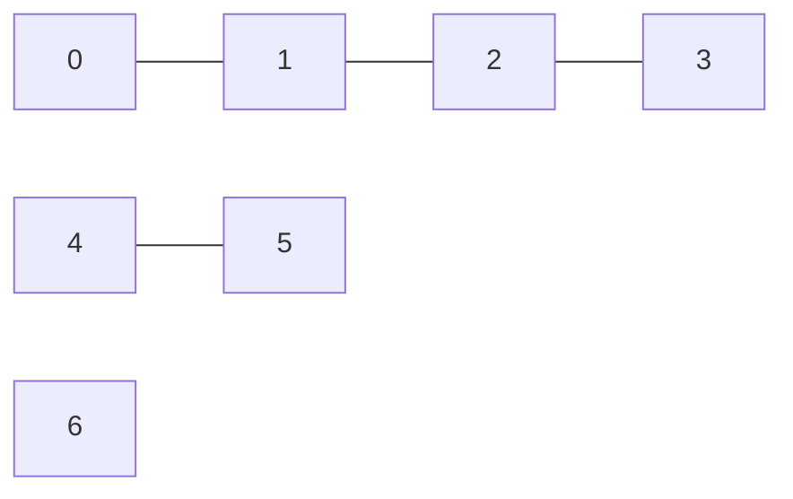

# Разбор 05 — Кандидаты

> [Разбор 00 — Оглавление](README.md) · предыдущая: [Разбор 04 — Оракул ценности](04-value-oracle.md) · следующая: [Разбор 06 — Выбор разбиения](06-partition.md)
> Файл: `src/coalitions_badretdinov/candidates.py`, 100 строк.

## Зачем нужен

Прежде чем выбирать, кого объединить, нужно понять, **кого вообще можно объединить**. Среда примет план, только если его участники связаны между собой (часть 02, раздел 4.1). Этот модуль составляет список таких групп — **кандидатов**.

## Теория графов: минимум

- **Граф** — точки (агенты) и линии между ними (связи).
- **Путь** — последовательность связей от одного агента к другому.
- **Связная группа** — из любого участника можно дойти до любого, **не выходя за пределы группы**.
- **Компонента связности** — максимальная связная группа: добавить к ней никого нельзя.
- **Точка сочленения** — агент, без которого группа распадается.



Здесь три компоненты: $\{0,1,2,3\}$, $\{4,5\}$ и одиночка $\{6\}$. Агенты 1 и 2 — точки сочленения: без 1 агент 0 отрезан.

**Важное следствие:** группа $\{0,2\}$ не связна, хотя оба агента в одной компоненте. Путь между ними идёт через 1, которого в группе нет.

## Какие группы годятся: `eligible_agents` (строки 20–22)

```python
return set(observation.active_agents) - set(observation.restricted)
```

Только активные агенты без долгов. Затем из них убираются **временно исключённые** (`blocked`, часть 10).

## Главная функция: `generate_candidates` (строки 25–52)

Работает по режиму структуры:

| Режим | Что возвращает |
|---|---|
| `antagonism` | Пустой список |
| `grand` | Все активные одной группой, только если они — одна компонента связности. Иначе ничего |
| `adaptive` | Компоненты, прошлые группы, сообщества |
| `partial` | То же, но каждая группа разрезана на куски не больше половины агентов |

### Три источника кандидатов в режиме `adaptive`

**1. Компоненты связности.** Самые большие возможные группы. Считаются функцией среды `connected_components`. Внутри она использует обход графа: начать с агента, пометить всех соседей, потом их соседей, и так далее.

**2. Прошлые группы** (`_still_valid`, строки 59–60). Если прошлая группа ещё связна и все её участники допустимы, она остаётся кандидатом. Это нужно для устойчивости: постоянные партнёры копят память $H_{ij}$, и связи между ними крепнут.

**3. Сообщества** (`_communities`, строки 73–85). Большую компоненту часто выгоднее разбить на плотные части, а не брать целиком: в разреженном графе такие части устойчивее (часть 06).

## Теория: сообщества и модулярность

**Сообщество** — группа, внутри которой связей заметно больше, чем между группами. Качество деления на сообщества меряет **модулярность**:

$$\mathcal Q=\frac{1}{2m}\sum_{i,j}\Bigl(A_{ij}-\frac{k_ik_j}{2m}\Bigr)\,[\,i\text{ и }j\text{ в одном сообществе}\,]$$

| Символ | Смысл |
|---|---|
| $A_{ij}$ | Вес связи $i$–$j$, 0 если её нет |
| $k_i$ | Сумма весов связей агента $i$ |
| $m$ | Сумма весов всех связей |
| $k_ik_j/2m$ | Сколько веса было бы между $i$ и $j$ при случайных связях |

Модулярность высока, когда внутри групп связей больше, чем было бы случайно. Код вызывает `greedy_modularity_communities` из NetworkX: алгоритм Клаузета — Ньюмана — Мура. Он начинает с одиночек и каждый раз сливает пару групп, которая сильнее всего поднимает $\mathcal Q$.

**Вес связи** (строки 63–70) — $1+H_{ij}$. Память кооперации лежит в $[-1,1]$, а алгоритму нужны неотрицательные веса. Так пары, которые вместе соблюдали планы, «держатся» в одном сообществе крепче.

**Подвох:** сообщество может оказаться несвязным, если его участники связаны через агентов из другого сообщества. Поэтому каждое сообщество ещё раз делится на компоненты связности (строка 84). Компоненты меньше 4 агентов на сообщества не делятся.

## Режим `partial`: разрезание `_split` (строки 88–100)

Группа больше предела режется на связные куски:

1. Берётся агент с **наименьшим числом связей**. С краю он реже остаётся одиночкой в конце.
2. Обход в ширину от него собирает первых `limit` агентов. Обход в ширину идёт «волнами» по соседям, поэтому кусок получается связным.
3. Кусок удаляется из графа, повторяется с остатком.

Пример: полный граф из 6 агентов, предел 3 → два куска по 3.

## Исключённые агенты меняют кандидатов

Исключённые убираются **до** поиска компонент (строка 37). Если исключена точка сочленения, бывшая группа распадается на части, и кандидатами станут эти части. Это правильно: без неё части действительно не связаны.

## Тесты

| Тест | Что проверяет |
|---|---|
| `test_candidates_are_connected_and_skip_restricted` | Агент с долгом не попадает в группы, группы связны |
| `test_partial_mode_limits_group_size` | В режиме `partial` все группы от 2 до 3 агентов при 6 активных |
| `test_modes_without_candidates_on_split_graph` | `antagonism` и `grand` на несвязном графе дают пустой список |

## Ограничения

- Кандидаты не включают все возможные связные группы, их экспоненциально много. Берутся только самые осмысленные.
- Сообщества строятся по текущему графу и памяти, а не по экономике. Экономику учитывает следующий шаг (часть 06).
- В режиме `grand` агент с долгом делает гранд-коалицию невозможной, потому что его нельзя включить в план.
