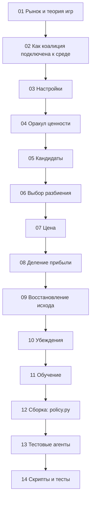

# Разбор кода коалиции — оглавление

> Подробный разбор всего кода коалиции для человека, который ничего не знает о проекте.
> Код: ветка `coalition` этого репозитория, [`src/coalitions_badretdinov`](../..) и подмодуль [`research`](../../research). Разбор соответствует коммиту `27c6a8e`: этапы 1–3.
> Короткая версия: [Коалиция — простое объяснение](../overview.md). Термины: [Коалиция — словарь](../glossary.md). Журнал разработки: [Коалиция — журнал разработки](../journal.md). Эксперименты ТЗ: [Коалиция — эксперименты ТЗ](../experiments.md).

## Как читать

Части идут от простого к сложному. Первые две не содержат нашего кода: они объясняют мир, в котором код работает. Без них остальное непонятно.



## Части

| № | Часть | Файлы | О чём |
|---|---|---|---|
| 01 | [Разбор 01 — Рынок и теория игр](01-market-and-game-theory.md) | среда | Спрос, доли, прибыль, Нэш, картель, почему сговор неустойчив |
| 02 | [Разбор 02 — Как коалиция подключена к среде](02-environment-contract.md) | среда | Шаг игры, что видит коалиция, что она отправляет, как делится котёл |
| 03 | [Разбор 03 — Настройки](03-settings.md) | `settings.py` | Все параметры и режимы |
| 04 | [Разбор 04 — Оракул ценности](04-value-oracle.md) | `value.py` | Равновесия и кэш |
| 05 | [Разбор 05 — Кандидаты](05-candidates.md) | `candidates.py` | Какие группы вообще можно предложить |
| 06 | [Разбор 06 — Выбор разбиения](06-partition.md) | `structure.py` | Какие группы взять одновременно |
| 07 | [Разбор 07 — Цена](07-pricing.md) | `pricing.py` | Какую цену рекомендовать |
| 08 | [Разбор 08 — Деление прибыли](08-payouts.md) | `payouts.py` | Шепли, Майерсон, Оуэн, ядро |
| 09 | [Разбор 09 — Восстановление исхода](09-outcome-restoring.md) | `rewards.py` | Что случилось на прошлом шаге |
| 10 | [Разбор 10 — Убеждения](10-beliefs.md) | `beliefs.py` | Доверие, штрафы, выживание связей |
| 11 | [Разбор 11 — Обучение](11-learning.md) | `learner.py` | Контекстный бандит |
| 12 | [Разбор 12 — Сборка](12-policy-assembly.md) | `policy.py` | Как всё соединяется в один шаг |
| 13 | [Разбор 13 — Тестовые агенты](13-test-agents.md) | `research/agents.py` | Противники, которые умеют обманывать |
| 14 | [Разбор 14 — Скрипты и тесты](14-scripts-and-tests.md) | `research/`, `tests/`, конфиг | Как всё запускается и проверяется |

## Карта: файл → часть

```text
src/coalitions_badretdinov/
├── __init__.py      12
├── settings.py      03
├── value.py         04
├── candidates.py    05
├── structure.py     06
├── pricing.py       07
├── payouts.py       08
├── rewards.py       09
├── beliefs.py       10
├── learner.py       11
└── policy.py        12
src/coalitions_badretdinov/research/agents.py           13
src/coalitions_badretdinov/research/compare.py         14
src/coalitions_badretdinov/research/train_bandit.py            14
src/coalitions_badretdinov/coalitions_badretdinov.yaml     14
src/coalitions_badretdinov/research/bandit.json     11, 14
tests/test_coalitions_badretdinov_*.py             14
```

## Обозначения

Эти символы встречаются во всех частях.

| Символ        | Смысл                                     | Типичное значение     |
| ------------- | ----------------------------------------- | --------------------- |
| $N$           | Число агентов                             | 12                    |
| $i, j$        | Номера агентов                            | 0…11                  |
| $c_i$         | Себестоимость агента                      | 15–22                 |
| $p_i$         | Цена агента                               | 1–100                 |
| $\bar p$      | Средняя цена                              | ~24 при конкуренции   |
| $A, B$        | Параметры спроса                          | 120, 1                |
| $\tau$        | «Температура» покупателей                 | 5                     |
| $Q$           | Общий спрос                               | ~96 при конкуренции   |
| $s_i$         | Доля рынка агента                         | ~1/12                 |
| $q_i = Q s_i$ | Продажи агента                            |                       |
| $\pi_i$       | Прибыль агента                            | ~43.5 при конкуренции |
| $SW$, $SW^*$  | Благосостояние и его конкурентный уровень | ~4615                 |
| $C$, $S$      | Коалиция, подмножество агентов            |                       |
| $v(S)$        | Ценность подмножества                     |                       |
| $w_i$         | Вес (доля котла)                          | в сумме 1             |
| $T_i$         | Соблазн: прибыль при обмане               |                       |
| $\delta$      | Терпеливость                              | 0…1                   |
| $H_{ij}$      | Память кооперации пары                    | −1…1                  |
| $c_{ij}$      | Стоимость связи                           | 0…10                  |
| $\lambda$     | Доля пути цены от Нэша к цели             | 0…1                   |
